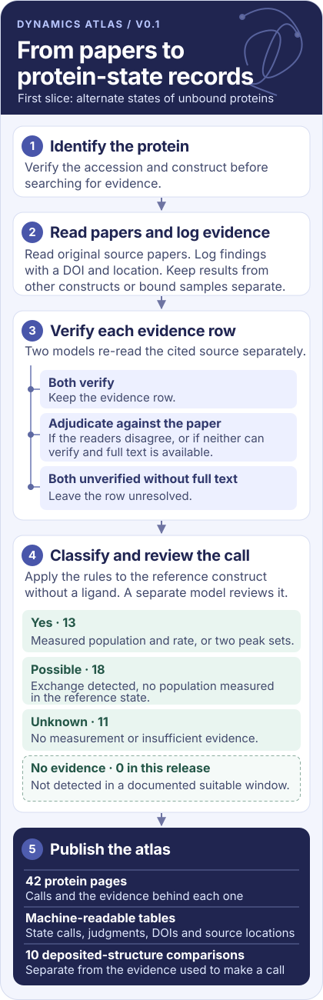

# Dynamics Atlas

**An evidence-linked atlas of alternate shapes in unbound proteins.** Dynamics Atlas turns scattered experimental reports into protein pages and machine-readable records. Readers can see what each call means, trace it to the source, and tell where evidence runs out.

[Browse the atlas](atlas/README.md) · [Data dictionary](data/DATA_DICTIONARY.md) · [Quality report](methods/quality.md)

## What shipped

The first public snapshot, **v0.0 (October 20, 2026)**, included 42 protein calls and structure comparisons for seven proteins. **v0.1 (October 21, 2026)** added individual protein pages and expanded the comparisons to all ten CPMG proteins in the 42-protein slice. Under the release rules, 13 calls were **yes**, 18 **possible**, and 11 **unknown**. [Changelog](CHANGELOG.md) · [Classification rules](methods/definitions.md)

## A verification failure changed the workflow

The first seeded-error test caught **13 of 20** errors. All seven misses were rows both readers marked unverified, so none reached adjudication. The fix sends those rows to adjudication whenever full text is available. A new seeded test caught **20 of 20** and flagged **1 of 38** unaltered rows. This test measures agreement between Atlas records and their cited papers. [Test details](methods/quality.md)
