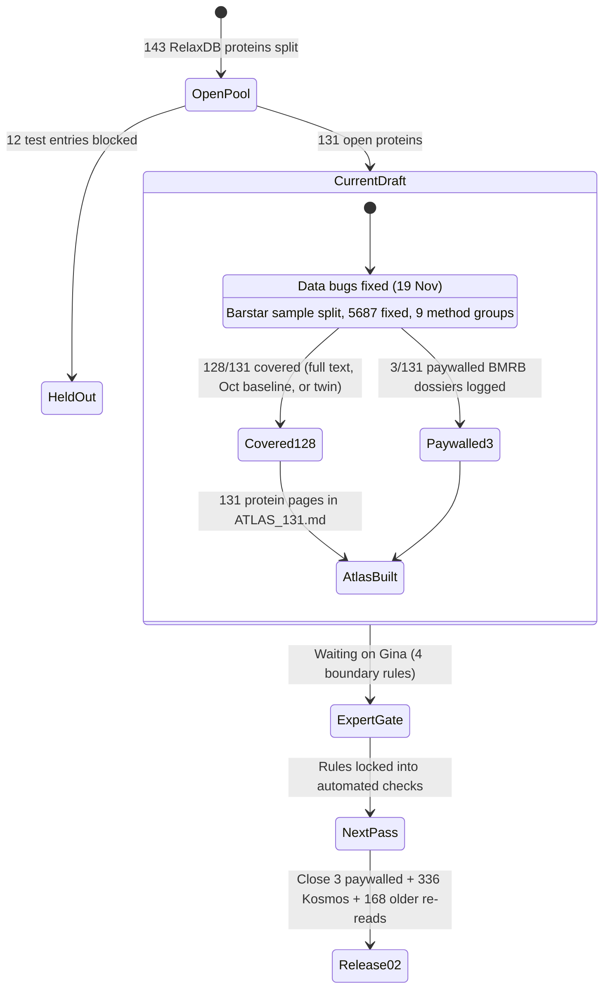

# Dynamics Atlas

**Dynamics Atlas** is an open, quote-grounded database of experimental protein conformational dynamics and structural states extracted from published literature. It is built for biophysicists and ensemble-modeling benchmarks.

> **Current review draft (`review/expert-check-20261119`).**  
> Every open RelaxDB protein (`131 / 131`) now has a dedicated page in **[`atlas/ATLAS_131.md`](atlas/ATLAS_131.md)**. The `12` held-out test entries remain physically excluded. This draft unifies our **October baseline** (`42` expert-reviewed pages on `main`) with our **November full-text extraction** (`108` entries, `757` papers) and our November 19 bug fixes. Coverage now reaches **`128 / 131` (`97.7%`)** through full text, the October baseline, or shared UniProt entries. Only **`3`** proteins (`15795`, `18477`, `50734`) sit behind publisher paywalls with their DOIs and abstracts logged. All new November rows await NMR expert sign-off before Release `0.2`.

---

## Project state at a glance

---

## Start here (15-minute review path for Gina and Soojung)

1. **[`data/expert_review_20261119/RelaxDB_expert_review_DRAFT.xlsx`](data/expert_review_20261119/RelaxDB_expert_review_DRAFT.xlsx)** ([notes & CLI](data/expert_review_20261119/README.md)) is the **15-tab clickable Expert Review Workbook**, paired with a **queryable SQLite database** ([`RelaxDB_expert_review_DRAFT.sqlite`](data/expert_review_20261119/RelaxDB_expert_review_DRAFT.sqlite)) and zero-dependency CLI ([`query_atlas.py`](data/expert_review_20261119/query_atlas.py)). It adds `Data_quality_audit` (`9` automated gates), `BMRB_recovered` (`37,131` live per-residue values across `62 / 68` BMRB deposits), and `SI_S3_inventory` (`386` gap DOIs audited on AWS S3, `43` direct SI spreadsheets).
2. **[`atlas/ATLAS_131.md`](atlas/ATLAS_131.md)** is the web-browsable **131-Protein Dynamics Atlas**. Entries are grouped into 4 evidence tiers with MD simulations and cryo-X-ray separated from solution exchange.
3. **[`REVIEW_GUIDE.md`](REVIEW_GUIDE.md)** lists the 4 scientific boundary rules we need Gina to settle before running the next pass.
4. **[`atlas/walkthrough_ets1.md`](atlas/walkthrough_ets1.md)** walks through one full paper from raw text to extracted rows (murine Ets-1, *Biochemistry* 2016).
5. **[`atlas/v3_previews/README.md`](atlas/v3_previews/README.md)** collects 4 deep case studies (`FKBP12`, `GR / DBD82`, `CheA`, `TEM-1 & Barstar`) illustrating those 4 rules.
6. **[`methods/how_it_is_built.md`](methods/how_it_is_built.md)** and **[`methods/bugs_and_fixes.md`](methods/bugs_and_fixes.md)** explain our 7-step workflow and clearly separate bugs **already fixed** from automated gates planned for the next pass.

---

## How the pipeline fits together

Our pipeline merges verified literature-curation methods onto deterministic Python checks. Full comparisons live in [`methods/how_it_is_built.md`](methods/how_it_is_built.md).

- **Bindwell per-paper gold keys.** We built manual answer keys for four papers (`arginine kinase`, `CRABP2`, `p38 gamma`, `IscU`) before grading extraction. The extractor recovered `85 / 86` core rates and populations (`102 / 102` Table 1 cells exact on arginine kinase).
- **Elicit cited-cell pattern + table linearization.** Every kept measurement carries sample metadata, section locator, and a verbatim substring quote (`776 / 776` records pass). PMC XML tables are flattened line by line so no table can be skipped silently.
- **Edison / PaperQA as search probe only.** Published Kosmos benchmarks showed `57.9%` accuracy on synthesis statements. External retrieval tools therefore supply candidate DOIs in Step 1 only and never write database rows directly.
- **October baseline synthesis & structure overlays.** Our `42` October baseline protein pages (`main`), apo/holo PDB overlays on `10` CPMG proteins, and raw BMRB checks are now connected directly inside [`atlas/ATLAS_131.md`](atlas/ATLAS_131.md).

---

## Honest coverage across all `131` open RelaxDB proteins

RelaxDB holds `143` proteins. We block `12` held-out test entries physically and report exact unified coverage across all `131` open entries below.

| Metric | Count | Plain status |
|---|---:|---|
| Open proteins with a dedicated Atlas page | `131 / 131` | [`atlas/ATLAS_131.md`](atlas/ATLAS_131.md) + `atlas/all_proteins/<entry>.md` unifying the October baseline and November reads |
| Covered by full text, October baseline, or twin UniProt | `128 / 131` | `108` with checked November papers (`757` unique DOIs, `19,989` rows) + `17` October-only + `3` shared UniProts |
| Atlas Tier 1 (experimental exchange rates or pops) | `42 / 131` | Solution NMR/HDX/EPR/FRET rates & pops (`575` rows on `Exchange_Highlights`) + October `yes` calls; MD/cryo-X-ray separated |
| Atlas Tier 2 (quantitative relaxation/HDX/DEER/FRET) | `57 / 131` | Includes newly read `15451` (`2JUO`, `τc`), `5841` (`1MZK`, `S2/τm/Rex`), and `CMTIV` (`abstract_only` `S2`) |
| Atlas Tier 3 (qualitative / October `unknown` / 0-row) | `29 / 131` | Includes newly read `5687` (`S-824`, PDB `1P68`, fixed from `'x'` bug) and `3` shared-UniProt links |
| Atlas Tier 4 (paywalled BMRB source paper only) | `3 / 131` | `15795`, `18477`, `50734` (exact DOIs/PMIDs and BMRB/PubMed abstracts logged) |
| Remaining paused external backlog | `336` Kosmos + `168` older records | `219` of `244` earlier full-text DOIs were already in the October baseline; IscU `PNAS 2011` (`7432`) added; Kosmos ZIP & `168` older re-reads paused |
| Expert NMR verification of new November rows | `42` Oct / `0` new | October baseline (`42` proteins) had dual review; all new November rows await Gina's sign-off |

---

## Four scientific boundary rules we need Gina to settle

1. **Domain vs full-length protein indexing (`DBD82`, `CHEA`).** When a RelaxDB entry names one domain (`DBD82`, `CHEAYBD`), should papers on another domain (`GR LBD`) stay separate or merge under canonical `UniProt` ID with a `domain` tag?
2. **Inclusion line outside solution NMR (`DBD82`, `FKBP`).** Should `MD` simulations, `100 K` crystal dual occupancies, live-cell `FCS` diffusion, and `EMSA` DNA off-rates stay in a separate auxiliary tier rather than experimental exchange counts?
3. **Mandatory sample-splitting threshold (`BARSTAR`, `Ets-1`).** Confirm forcing a new `sample` ID whenever solvent isotopic fraction (`~1.8% H2O` vs `90% H2O`), `pH/pD`, temperature, or ligand ratio changes within one paper.
4. **Separating bulk relaxation arrays from exchange kinetics (`16392`).** Confirm keeping per-residue `R1/R2/NOE/S2` tables split from fitted `kex / pB` exchange tables (as previewed in `Exchange_Highlights` and `ATLAS_131.md`).

---

## Where everything lives in this repository

We keep the three atlas views cleanly separated so nothing overlaps:
- **[`atlas/ATLAS_131.md`](atlas/ATLAS_131.md)** is the main entry point covering all `131` open proteins.
- **[`atlas/v3_previews/`](atlas/v3_previews/README.md)** holds the `4` deep case studies for Gina's review.
- **[`atlas/proteins/`](atlas/README.md)** preserves the `42` October baseline pages from `main` untouched.

| Path | Contents | Status |
|---|---|---|
| [`atlas/ATLAS_131.md`](atlas/ATLAS_131.md) & `atlas/all_proteins/` | Complete **131-Protein Dynamics Atlas** (one page per open entry) | Current draft (19 Nov 2026) |
| [`REVIEW_GUIDE.md`](REVIEW_GUIDE.md) | 15-minute expert checklist, decision routing chart, and 4 ranked borderline calls | Current draft (19 Nov 2026) |
| [`atlas/walkthrough_ets1.md`](atlas/walkthrough_ets1.md) | End-to-end single-paper audit of murine Ets-1 (`doi:10.1021/acs.biochem.6b00460`) | Current draft (19 Nov 2026) |
| [`atlas/v3_previews/`](atlas/v3_previews/README.md) | Four deep case studies (`FKBP`, `DBD82`, `CHEA/CHEAYBD`, `16392 & BARSTAR`) | Current draft (19 Nov 2026) |
| [`figures/`](figures/) | Four centered 2x-DPI architecture, walkthrough, bug, and statechart figures | Updated (19 Nov 2026) |
| [`methods/how_it_is_built.md`](methods/how_it_is_built.md) | External tool comparison, 7-step workflow, and formally verified statechart | Updated (19 Nov 2026) |
| [`methods/bugs_and_fixes.md`](methods/bugs_and_fixes.md) | Five real audit bugs, fixes already applied, and automated gates for the next pass | Updated (19 Nov 2026) |
| [`methods/changes_since_v01.md`](methods/changes_since_v01.md) | Timeline from the October baseline to today and steps to Release `0.2` | Updated (19 Nov 2026) |
| [`methods/quality.md`](methods/quality.md) | Answer-key scores, blind checks, and prevalence caveats | Updated (19 Nov 2026) |
| [`methods/check_review_consistency.py`](methods/check_review_consistency.py) | Automated gate checking counts, links, leaks, Mermaid syntax, and plain language | New (19 Nov 2026) |
| [`data/expert_review_20261119/`](data/expert_review_20261119/README.md) | **15-tab clickable Expert Review Workbook + strict-typed SQLite DB + CLI** (`Data_quality_audit`, `BMRB_recovered` [`37,131` vals], `SI_S3_inventory` [`386` DOIs], plus 7 lossless raw tables on `19,958 original` rows) | Updated (19 Nov 2026) |
| [`data/v3_draft_20261118/`](data/v3_draft_20261118/README.md) | Ten-tab Excel workbook (`Start_Here`, `Proteins`, `Exchange_Highlights` [`575` rows], lossless `Measurements` [`19,989` rows]), CSV summaries, and verified supplemental JSON | Current draft (19 Nov 2026) |
| [`atlas/README.md`](atlas/README.md) & [`atlas/proteins/`](atlas/README.md) | **October baseline (`21 Oct 2026`).** `42` alternate APO synthesis pages (`13 yes, 18 possible, 11 unknown`) | Preserved intact |
| [`data/*.csv`, `data/structures/`](data/DATA_DICTIONARY.md) | **October baseline (`21 Oct 2026`).** Curated tables, RelaxDB card audit, `10` CPMG structure overlays | Preserved intact |
| [`code/`](code/README.md) | **October baseline (`21 Oct 2026`).** Alternate APO pipeline scripts | Unchanged |
| [`CHANGELOG.md`](CHANGELOG.md) | Full release log from October to today | Updated (19 Nov 2026) |

This repository never stores copyrighted full texts, private keys, or the `12` held-out test ground truths.
