# Dynamics Atlas: alternate APO states in RelaxDB proteins

Updated 2026-10-21, US Eastern time. Work in progress.

## Why this exists

A protein in solution does not keep one shape. When it binds nothing (the APO state), it can spend a small part of its time in a second shape. We call that second shape an alternate APO state.

An example: free cyclophilin A (CypA). NMR measures a second shape at about 2%, which exchanges with the main shape more than a thousand times per second, near the active site. About three quarters of the CypA crystal structures in the PDB (133 of 176) were measured at 120 K or below. They show only the main shape. The second shape of the Phe113 side chain appears only in apo crystals measured at 240 K or above.

This is a general gap:

- The PDB leans towards bound (holo) states, because bound proteins crystallize more easily.
- Drugs usually meet the free (APO) protein.
- Some proteins have more than one APO state.
- Structure-prediction and co-folding models learn mostly from the PDB, so they do not see these states.

The rates and populations of such states are in NMR papers, but no database labels a protein with its APO states.

**Goal.** For each RelaxDB protein, give an answer with evidence. The answer says whether there is an alternate APO state, where it is (residues), how fast it exchanges (kex) and how populated it is (pB). It also says whether a deposited structure matches it. Every answer traces to a sentence in a paper. We build it with an agent pipeline that must scale to about 10,000 proteins.

**Users.** Dynamics predictors such as Dyna-1 can go from "which residues move" to "which states exist". Structure and co-folding models get a test set for alternate APO states. Drug discovery can find free targets that have a second shape, and where.

**Done means:**

1. Our NMR collaborator agrees with the definition and the calls.
2. Every call traces to a sentence in a paper.
3. Errors stay within pre-set limits as the work scales.

None of the three is met yet.

## The definition question

Our collaborator's working definition is strict: the second shape must exchange slowly enough for NMR to show two separate peaks. When exchange is fast, the two shapes average into one peak. "Slow" means that kex is much smaller than the frequency difference Δω between the two peaks.

CypA's exchange is fast to intermediate. It counts under a broad reading (a measured second shape), and it is uncertain under the strict reading. Which reading to use is the first open question for our collaborator.

## What we have so far

42 proteins have a call: the 10 RelaxDB proteins with CPMG data, and 32 of the 133 other RelaxDB entries.

| Call | Proteins | Meaning |
|---|---|---|
| yes | 13 | A minor state with a measured population and rate (CPMG, CEST or R1ρ), or a second peak set, in the reference state |
| possible | 18 | Exchange is detected in the reference state, but there is no population, or there is a population only in another condition |
| unknown | 11 | Not measured, or the key paper was readable only as an abstract |

The reference state is the RelaxDB entry construct as deposited, free of ligand.

Under the strict reading, 4 proteins qualify, 13 do not, and 25 cannot be decided from the papers. The 4 that qualify each have a caveat:

| Protein | Why it qualifies | Caveat |
|---|---|---|
| K-Ras4B·GTP | The authors call the exchange "moderately slow" and see a second CEST dip | The protein carries GTP |
| Azurin | Two peak sets with EXSY cross peaks, k = 45 ± 6 s⁻¹ | The sample is reduced Cu(I) azurin, and the exchange is coupled to His35 protonation |
| RfaH C-terminal domain | A second state is seen by CEST and zz-exchange | The second state is largely unfolded |
| eRF1 N-domain (entry 18092) | Duplicate peak sets, about 5:1 | No exchange measurement |

## What changed overnight (20 to 21 October)

We read 11 of the papers that RelaxDB took its data from. The project lead supplied them as PDFs, and one scanned paper went through OCR.

- Before: 12 yes, 11 possible, 19 unknown.
- After: 13 yes, 18 possible, 11 unknown.
- Azurin moved to yes, because the full text gives the sample state and the EXSY rate.
- Seven proteins moved from unknown to possible on full-text evidence. They are RNase HI, calbindin D9k, thioredoxin, TGF-α, an anti-digoxin VL domain, the TTF-1 homeodomain and SilB.
- VcPth moved to possible because of a rule, not new evidence. The rule: Rex that the authors report from a single-field relaxation analysis counts as exchange detected. The fixed caveat is that anisotropic tumbling can mimic Rex.

Each re-read went through two independent re-reads, adjudication against the paper and an independent review.

## Do the states match deposited structures?

We compared the downloaded PDB structures of the 10 CPMG proteins. We superposed each chain on its rigid core. Then we measured where its mobile region sits between two reference structures. See `results/pdb_states/` and `reports/PDB_STATES_PILOT_ZH.md`.

- No ligand-free crystal structure of these 10 proteins has the other state's backbone. For K-Ras, "ligand-free" means nucleotide only.
- For adenylate kinase and arginine kinase, the closed state appears only with ligand bound. PDBe-KB clustering agrees.
- CypA is the one clear match. The occupancy of the second Phe113 rotamer rises with temperature, from 0.11 at 240 K to 0.49 at 300 K. It is absent below 240 K and in all ligand-bound or complex chains.
- For 7 of the 10 proteins, the two literature states differ by 1.2 Å or less in Cα. A backbone comparison says little for these proteins.

## How much to trust the numbers

We ran a pre-registered test on 20 RelaxDB-133 proteins (`reports/BATCH3_FEASIBILITY_ZH.md`).

| Check | Result | Pass? |
|---|---|---|
| Proteins that reached a reviewed call | 20 of 20 | yes |
| Rows corrected after the double re-read | 18.9 per 100 rows | no (limit 15). 110 of the 153 corrections are in thioredoxin. Most come from one error: E. coli thioredoxin has the entry's exact sequence but was labelled a homolog. The fix is in place and tested. |
| Planted errors that the re-read caught | 13 of 20, then 20 of 20 on a new planted set after a rule fix | no, then yes |
| Machine time per protein | median 24 minutes | yes |
| External NMR papers found by the search | 11 of 15 (10 of 15 without the RelaxDB source papers as seeds) | at the limit |
| Number or sample errors found by the final review | 0.55 per protein | yes (limit 1) |

All readers and reviewers so far are language models. No person has checked the rows yet. A passed check shows that a row matches the cited paper. It does not show that the experiment in the paper is correct.

## How the work is done

```mermaid
flowchart LR
  A[RelaxDB entry] -->|identity check| B[Search]
  B -->|candidate papers| C[Screen]
  C -->|A/B papers| D[Read and fill rows]
  D -->|rows + quotes| E[Two independent re-reads]
  E -->|flagged rows| F[Adjudicate against the paper]
  F -->|corrected rows| G[Draft judgments]
  G -->|judgments| H[Independent review]
  H -->|reviewed calls| I[Results]
```

Start at the left. Each step writes files, and each later step reads only those files. `method/PIPELINE.md` describes each step and its check.

## Where things are

| Folder | Contents |
|---|---|
| `results/` | The calls (`alternate_apo_states.csv`), judgments per protein, evidence rows with citations, PDB-state tables, data issues found in RelaxDB, and the error log. Column definitions are in `results/README.md`. |
| `reports/` | Dated reports in Chinese: the feasibility test, drift checks, independent reviews, the PDB-state study, and why calls are "unknown". `reports/README.md` lists them in English. |
| `method/` | How the pipeline works and how each step is checked. |
| `code/` | The pipeline code, worker prompts, the judgment contract, search configuration and tests. |

## What is not in this repository

- Full texts and abstracts of papers. They are copyrighted. Each evidence row gives the DOI and a short quote.
- The test keys for the planted-error and recall tests. If they were public, the tests would no longer be independent.
- Run folders, downloaded PDB files and messages to collaborators.

## Next steps

1. Ask our NMR collaborator which reading of "alternate APO state" to use. Also ask three smaller questions. Does single-field Rex count? Does a metal-bound, protonation-coupled state count? Can a near-identical variant stand in for the entry construct?
2. Compare the measured minor-state chemical shifts with shifts predicted from candidate structures. This needs a shift-prediction program, which is not installed yet.
3. Get the 3 missing PDFs. Then continue through the 133 entries with the fixes in place.
