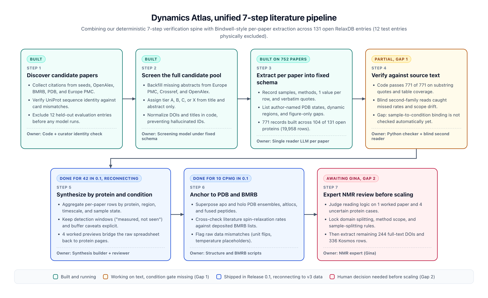

# Dynamics Atlas

**Dynamics Atlas** is an open, sentence-grounded database of experimental protein conformational dynamics and structural states extracted from published literature, built for biophysicists and ensemble-modeling benchmarks.

> **Unified 131-Protein Atlas checkpoint (`review/expert-check-20261119`).**  
> Every open RelaxDB entry (`131 / 131`; `12` held-out entries excluded) now has a dedicated protein-level synthesis page in **[`atlas/ATLAS_131.md`](atlas/ATLAS_131.md)** unifying Release `0.1` (`42` expert-reviewed pages), `v3` full-text extraction (`104` entries), and `2026-11-19` supplemental reads & bug fixes (`15451`, `5841`, `5687`, `CMTIV`, `7432`, and `BARSTAR` `S1`/`S2` split). **`128 / 131` (`97.7%`) open entries now have full-text literature coverage or twin-UniProt links; only `3` (`15795`, `18477`, `50734`) remain behind publisher paywalls (DOIs and abstracts logged).** All `v3` rows await NMR specialist sign-off before promotion to Release `0.2`.

---

## Start here (15-minute review path for Gina and Soojung)

1. **[`atlas/ATLAS_131.md`](atlas/ATLAS_131.md)** is the complete **131-Protein Dynamics Atlas** (one page per protein in `atlas/all_proteins/`, grouped into 4 evidence tiers with MD/cryo-X-ray separated from solution exchange).
2. **[`REVIEW_GUIDE.md`](REVIEW_GUIDE.md)** gives the exact 4 borderline scientific rules we need you to settle before running `v4`.
3. **[`atlas/walkthrough_ets1.md`](atlas/walkthrough_ets1.md)** walks through one complete paper from raw text to extracted table rows (murine Ets-1, *Biochemistry* 2016).
4. **[`atlas/v3_previews/README.md`](atlas/v3_previews/README.md)** shows 4 deep worked protein syntheses (`FKBP12`, `GR / DBD82`, `CheA`, `TEM-1 & Barstar`) illustrating the 4 boundary calls.
5. **[`methods/how_it_is_built.md`](methods/how_it_is_built.md)** and **[`methods/bugs_and_fixes.md`](methods/bugs_and_fixes.md)** show how our workflow fuses external literature-mining methods (Bindwell, Elicit, PaperQA/Kosmos) onto deterministic checks, and record which bugs are **already fixed in this draft** vs queued for `v4`.

---

## How the pipeline fits together

Rather than writing custom prompts from scratch, our design merges verified components from recent curation work onto a strict verification spine described in detail in [`methods/how_it_is_built.md`](methods/how_it_is_built.md).

- **Bindwell per-paper rubrics (`KEY_FORMAT`).** Before grading any automated extraction, we wrote gold answer keys for four papers (`arginine kinase`, `CRABP2`, `p38 gamma`, `IscU`) and recovered `85 / 86` core rates and populations (`102 / 102` Table 1 cells matching publisher XML on arginine kinase).
- **Elicit cited-cell pattern + table linearization.** Every kept measurement carries sample metadata, section locator, and an exact substring quote (`771 / 771` pass), with PMC XML tables flattened line by line and checked so no table can be falsely skipped as empty.
- **Edison / PaperQA as search probe only, never source of truth.** Published Kosmos evaluations showed `57.9%` accuracy on synthesis statements, so external retrieval tools feed candidate DOIs into Step 1 only.
- **Release `0.1` synthesis & structure overlay.** Our October 21 pipeline (`42` proteins, apo/holo PDB ensembles on `10` CPMG proteins, raw BMRB cross-checks) provides the per-protein summary layer we are now reconnecting to the scaled extraction data.

---

## Honest status across the `131` open RelaxDB proteins

We split RelaxDB's `143` proteins into `131` open development entries and `12` held-out test entries (physically blocked from all reading scripts). Here is what is done today, and what is intentionally paused pending expert review.

| Metric | Count | Plain status |
|---|---:|---|
| Open proteins with a Protein-Level Atlas page | `131 / 131` | [`atlas/ATLAS_131.md`](atlas/ATLAS_131.md) + `atlas/all_proteins/<entry>.md` unifying Release `0.1`, `v3`, and `2026-11-19` reads |
| Covered by full text, Release `0.1`, or twin UniProt | `128 / 131` | `108` with checked `v3`/supplemental papers (`757` unique DOIs, `19,989` rows) + `17` Release `0.1`-only + `3` twin UniProts |
| Atlas Tier 1 (experimental exchange rates or pops) | `42 / 131` | Solution NMR/HDX/EPR/FRET rates & pops (`575` rows on `Exchange_Highlights`) + Release `0.1` `yes` calls; MD/cryo-X-ray separated |
| Atlas Tier 2 (quantitative relaxation/HDX/DEER/FRET) | `57 / 131` | Includes newly read `15451` (`2JUO`, `τc`), `5841` (`1MZK`, `S2/τm/Rex`), and `CMTIV` (`abstract_only` `S2`) |
| Atlas Tier 3 (qualitative / Release `0.1` unknown / 0-row) | `29 / 131` | Includes newly read `5687` (`S-824`, PDB `1P68`, fixed from `'x'` bug) and `3` twin UniProt pointers |
| Atlas Tier 4 (paywalled BMRB source paper only) | `3 / 131` | `15795`, `18477`, `50734` (exact DOIs/PMIDs and BMRB/PubMed abstracts logged) |
| Remaining paused external backlog | `336` Kosmos + `168` early `v3` | `219` of the `244` Nov-12 full-text DOIs were already in Release `0.1`; IscU `PNAS 2011` (`7432`) added; Kosmos ZIP & early `168` re-reads paused |
| Expert NMR verification of `v3` rows (`Step 7`) | `42` R0.1 / `0` new `v3` | Release `0.1` (`42` proteins) had dual review; all `v3` rows await Gina's sign-off |

---

## Four concrete questions we need Gina to settle

1. **Domain vs full-length protein indexing (`DBD82`, `CHEA`).** When a RelaxDB entry names one domain (`DBD82`, `CHEAYBD`), should papers on another domain (`GR LBD`) stay separate or merge under canonical `UniProt` ID with a `domain` tag?
2. **Inclusion line outside solution NMR (`DBD82`, `FKBP`).** Should `MD` simulations, `100 K` crystal dual occupancies, live-cell `FCS` diffusion, and `EMSA` DNA off-rates leave the main measurement table or stay in a separate auxiliary tier?
3. **Sample-splitting rule (`BARSTAR`, `Ets-1`).** Confirm requiring separate sample blocks whenever solvent isotopic fraction (`~1.8% H2O` vs `90% H2O`), `pH/pD`, temperature, or ligand ratio changes within one paper.
4. **Separating bulk baseline arrays from exchange kinetics (`16392`).** Should per-residue `R1/R2/NOE/S2` lists sit in their own linked sheet so rare `kex / pB` exchange measurements and PDB states remain easy to inspect?

---

## Repository map

| Path | Contents | Status |
|---|---|---|
| [`atlas/ATLAS_131.md`](atlas/ATLAS_131.md) & `atlas/all_proteins/` | Complete **131-Protein Dynamics Atlas** (one page per open entry, unifying Release `0.1` + `v3` + `2026-11-19` reads) | New (19 Nov 2026) |
| [`REVIEW_GUIDE.md`](REVIEW_GUIDE.md) | 15-minute expert checklist and 4 ranked borderline decisions | New (19 Nov 2026) |
| [`atlas/walkthrough_ets1.md`](atlas/walkthrough_ets1.md) | End-to-end single-paper audit of murine Ets-1 (`doi:10.1021/acs.biochem.6b00460`) | New (19 Nov 2026) |
| [`atlas/v3_previews/`](atlas/v3_previews/README.md) | Four worked protein syntheses (`FKBP`, `DBD82`, `CHEA/CHEAYBD`, `16392 & BARSTAR`) | New (19 Nov 2026) |
| [`figures/`](figures/) | Four centered 2x-DPI architecture, walkthrough, bug, and statechart figures | New (19 Nov 2026) |
| [`methods/how_it_is_built.md`](methods/how_it_is_built.md) | Literature comparison (Bindwell, Elicit, PaperQA/Kosmos), 7-step map, and formal statechart | Updated (19 Nov 2026) |
| [`methods/bugs_and_fixes.md`](methods/bugs_and_fixes.md) | Five real audit failure modes, fixes already applied in this branch, and `v4` schema gates | Updated (19 Nov 2026) |
| [`methods/changes_since_v01.md`](methods/changes_since_v01.md) | Timeline from Sept 29 / Oct 21 to Nov 19 and roadmap to Release `0.3` | New (19 Nov 2026) |
| [`methods/quality.md`](methods/quality.md) | Full batch metrics, answer-key scores, blind checks, and prevalence caveats | Updated (19 Nov 2026) |
| [`data/v3_draft_20261118/`](data/v3_draft_20261118/README.md) | Ten-tab Excel workbook (`Start_Here`, `Proteins`, `Exchange_Highlights` [`575` rows], lossless `Measurements` [`19,989` rows]), `supplemental_reads/`, `proteins_summary.csv`, `coverage_gap_audit.csv` | Draft (updated 19 Nov 2026) |
| [`atlas/README.md`](atlas/README.md) & [`atlas/proteins/`](atlas/README.md) | **Release `0.1` (`21 Oct 2026`).** `42` alternate APO synthesis pages (`13 yes, 18 possible, 11 unknown`) | Preserved intact |
| [`data/*.csv`, `data/structures/`](data/DATA_DICTIONARY.md) | **Release `0.1` (`21 Oct 2026`).** Slice 1 tables, RelaxDB data issues, `10` CPMG structure overlays | Preserved intact |
| [`code/`](code/README.md) | **Release `0.1` (`21 Oct 2026`).** Alternate APO pipeline scripts (November extraction scripts live in the external run ledger) | Unchanged |
| [`CHANGELOG.md`](CHANGELOG.md) | Release log across `0.0`, `0.1`, and `0.2-draft` | Updated (19 Nov 2026) |

This repository never stores copyrighted full texts, private keys, or the `12` held-out test ground truths.
