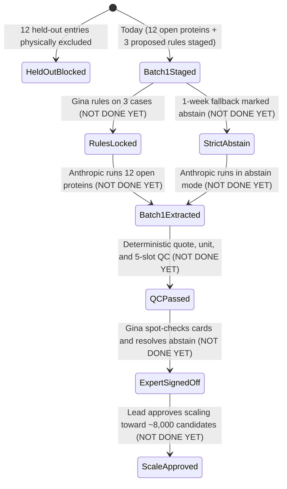

# Dynamics Atlas

**Dynamics Atlas** is an open, quote-grounded database and verification pipeline for experimental protein conformational dynamics extracted from published literature. It captures quantitative exchange parameters and qualitative dynamics observations (dynamic regions, alternate states, and transient pockets) tied to verbatim source quotes and exact sample conditions.

> **Current branch (`update/post-anthropic-20261126`).** This branch adds the unified Python contract and QC package ([`atlas_pipeline/`](atlas_pipeline/)), the 2-minute proposed boundary rules ([`PROPOSED_RULES_20261126.md`](PROPOSED_RULES_20261126.md)), the draft Anthropic Batch 1 handoff ([`ANTHROPIC_HANDOFF.md`](ANTHROPIC_HANDOFF.md)), and honest separate snapshot denominators below. `main` (`f8cde2f`) and the frozen 16-tab review branch (`review/expert-check-20261119`) remain untouched. All `12` held-out test entries remain physically excluded.

---

## Active workflow gate

TLC exhaustively verified [`WorkflowPostAnthropic.tla`](methods/statechart/WorkflowPostAnthropic.tla) across `13` chart states and `14` transitions (`15` model states; `13` allowed states, `0` broken safety rules; [`summary.json`](methods/statechart/summary.json)). A companion reachability check confirms scaling approval is reachable in `6` steps ([`reachability_stories.md`](methods/statechart/reachability_stories.md)).

**Four rules proved on the locked workflow:**
1. **Held-out isolation (code-enforced).** The `12` held-out test entries never enter staging, Anthropic extraction, QC, expert review, or broad scaling.
2. **Deterministic QC before review (code-enforced).** Raw Claude output never reaches expert sign-off without passing verbatim quote, unit, oligomer-vs-pB, and 5-slot condition checks.
3. **Strict-abstain boundary (human/process gate).** Output run under the 1-week strict-abstain fallback stays marked `abstain` and is never labeled expert-approved before Gina reviews.
4. **Evidence and expert gate before scaling (human/process gate).** Scaling toward ~`8,000` candidates never starts until Batch 1 runs on open proteins, passes deterministic QC, and completes Gina's sign-off.

**Two unguarded manual shortcuts audited today:** Checking [`WorkflowPostAnthropicRisk.tla`](methods/statechart/WorkflowPostAnthropicRisk.tla) against the locked workflow (`15` chart states, `28` transitions from `25` model states; `0` stay broken once locked) flags two shortcuts that code does not yet lock. One launches ~`8,000` scaling before Batch 1 QC and sign-off ([`bug-1.png`](methods/statechart/bug-1.png), `9` counterexamples). The other marks a 1-week strict-abstain batch expert-approved without Gina ([`bug-2.png`](methods/statechart/bug-2.png), `2` counterexamples). Full traces live in [`methods/statechart/stories.md`](methods/statechart/stories.md).

**What this model leaves out:** The model verifies gate order and label separation only. It does not model paper paywalls, unverified RelaxDB-to-UniProt sequence mismatches, raster figure readability, prompt drift inside Claude, or actual API dollar cost.

| Step | What is checked | Who decides (fixed rule vs judgment) | Evidence file | Status |
|---|---|---|---|---|
| **1. Exclude held-out & stage Batch 1** | Block `12` held-out entries; stage `12` open Batch 1 proteins and `3` proposed rules | Program (fixed rule) | [`data/batch1_open_proteins_draft.json`](data/batch1_open_proteins_draft.json), [`PROPOSED_RULES_20261126.md`](PROPOSED_RULES_20261126.md) | **Done** |
| **2A. Lock 3 boundary rules** | Rule `keep`, `re-scope`, or `insufficient` on `AQADK`, `Plexin-B1`, and `TEM-1 vs BRD4` | NMR Expert Gina (judgment) | [`PROPOSED_RULES_20261126.md`](PROPOSED_RULES_20261126.md) | **NOT DONE YET** |
| **2B. 1-week strict-abstain fallback** | If no ruling arrives after 1 week, start Batch 1 marked `abstain` (not signed off) | Fixed timer rule | [`atlas_pipeline/ACTIVE_EXTRACTION_PROMPT.md`](atlas_pipeline/ACTIVE_EXTRACTION_PROMPT.md) | **NOT DONE YET** |
| **3. Run Batch 1 extraction** | Extract quantitative rows and qualitative observations from `12` open proteins using one canonical prompt | Anthropic / Claude (fixed prompt) | [`ANTHROPIC_HANDOFF.md`](ANTHROPIC_HANDOFF.md) | **NOT DONE YET** |
| **4. Run deterministic Python QC** | Verify verbatim quotes, physical units, oligomer-vs-pB guard, 5-slot conditions, and log cost; quarantine failures | Program (fixed rule) | [`atlas_pipeline/schema.py`](atlas_pipeline/schema.py), [`atlas_pipeline/compare.py`](atlas_pipeline/compare.py) | **Code built; Batch 1 NOT DONE YET** |
| **5. Expert spot-check & sign-off** | Spot-check Batch 1 review cards and resolve any `abstain` default records | NMR Expert Gina (judgment) | [`ANTHROPIC_HANDOFF.md`](ANTHROPIC_HANDOFF.md) | **NOT DONE YET** |
| **6. Approve broad scaling** | Review Batch 1 QC metrics, expert sign-off, and dollar cost before scaling toward ~`8,000` proteins | Project Lead (judgment) | [`methods/statechart/summary.json`](methods/statechart/summary.json) | **NOT DONE YET** |

Quick-glance Mermaid route (click to expand)

---

## Start here

1. **[`PROPOSED_RULES_20261126.md`](PROPOSED_RULES_20261126.md)** (2 minutes for Gina). Three concrete pilot cases (`AQADK`, `Plexin-B1`, `TEM-1 vs BRD4`) with verbatim quotes and proposed default rules. Reply `keep`, `re-scope`, or `insufficient` per case.
2. **[`ANTHROPIC_HANDOFF.md`](ANTHROPIC_HANDOFF.md)** (draft spec for Batch 1). Points to [`atlas_pipeline/ACTIVE_EXTRACTION_PROMPT.md`](atlas_pipeline/ACTIVE_EXTRACTION_PROMPT.md) as the single rule source, defines sample-level `uniprot_accession` and record-level `document_role`, and links [`data/batch1_open_proteins_draft.json`](data/batch1_open_proteins_draft.json) (`12` open non-pilot proteins).
3. **[`atlas_pipeline/`](atlas_pipeline/)** (canonical Python contract and QC harness). Pydantic v2 schema (`SampleSpec`, `MeasurementRow`, `QualitativeObservation`, `PaperRecord`), verbatim grounding, physical unit checks, 5-slot condition comparator, vector plot digitization, and SQLite persistence. Run self-contained public tests via `python3 tests/test_atlas_pipeline_public.py`.
4. **[`REVIEW_GUIDE.md`](REVIEW_GUIDE.md)** and **[`atlas/ATLAS_131.md`](atlas/ATLAS_131.md)**. Full 15-minute deep review path (`Ets-1` walkthrough, `4` case studies, and `131` open protein pages).

---

## Honest separate denominators (do not pool across snapshots)

RelaxDB contains `143` entries (`131` open entries; `12` held-out test entries physically blocked). Because four distinct snapshots measure different questions and scopes, we report each denominator separately.

| Snapshot | Scope and counts | What it proves vs what remains open |
|---|---|---|
| **Frozen Nov 18 audit baseline** ([`RelaxDB_expert_review_DRAFT.sqlite`](data/expert_review_20261119/README.md)) | `131` open entries: `104` with at least 1 paper read, `82` with raw measurements, `79` with clean numeric rows. `19,958 original` measurements = `17,864` clean + `2,094` quarantined. `515` qualitative residue sets (`92` entries), `794` PDB states (`78` entries), `109` region comparisons (`10` source-verified, `99` templates), `396` observations (`16` PDF-audited). | Machine-verified against the repo SQLite (`check_review_consistency.py`). Cleaning counts are not expert sign-off and not paper-level recall. |
| **Nov 19 supplemental review draft** ([`data/v3_draft_20261118/`](data/v3_draft_20261118/README.md)) | `108 / 131` open entries with November papers read (`776` entry-paper records, `757` distinct DOIs, `19,989` rows = `19,958 original + 31` supplemental rows); `3` paywalled BMRB entries logged (`15795`, `18477`, `50734`). | Fixes `BARSTAR` `S1`/`S2` solvent split, `5687` `'x'` collapse, and `9` controlled `method_group` buckets. New November rows still await NMR expert sign-off. |
| **Nov 23 local CPMG-10 verification prototype** (`atlas_pipeline/`) | `10 / 10` open RelaxDB-CPMG entries (`12` papers, `66` samples, `809 / 809` verbatim-grounded measurements, `525 / 683` strict 5-slot condition matches, `5 / 5` historical traps blocked, real `AQADK` Fig. S4f vector blind check `45 / 45`). | Proves deterministic grounding, unit checks, and condition scoring on all `10` CPMG entries. Local figure cards stay offline because publisher figure crops are `UNKNOWN_RESTRICTED`; `525 / 683` reflects ligand-state gaps in SI-only reference tables. |
| **Oct 21 historical baseline** (`main`, [`atlas/proteins/`](atlas/README.md)) | `42` expert-reviewed alternate-APO synthesis pages (`13` yes, `18` possible, `11` unknown) plus `10` CPMG PDB structure overlays (`data/structures/`). | Preserved untouched on `main` as a separate earlier scientific question; not pooled into November extraction totals. |

---

## How the pipeline works

Our pipeline combines per-paper gold keys (Bindwell pattern), verbatim quote provenance (Elicit pattern), deterministic Python gates (`atlas_pipeline/`), and expert NMR review. Full design notes live in [`methods/how_it_is_built.md`](methods/how_it_is_built.md) and [`methods/bugs_and_fixes.md`](methods/bugs_and_fixes.md).

- **Text and tables:** PMC JATS XML (`lxml`) and PDF main/SI extraction (`PyMuPDF` character offsets + `Docling` structured tables).
- **Figures:** Deterministic vector XY coordinate extraction for vector scatter plots, vision-assisted or manual reading for raster plots, and explicit abstain when unreadable.
- **Validation:** Strict Pydantic v2 schema, closed NMR unit dimensions, oligomer/dimer guard on conformational populations, and 5-slot sample/condition matching.

---

## Where everything lives

| Path | Contents | Status |
|---|---|---|
| [`PROPOSED_RULES_20261126.md`](PROPOSED_RULES_20261126.md) | 2-minute 3-rule sign-off (`AQADK`, `Plexin-B1`, `TEM-1 vs BRD4`) | Proposed (awaiting Gina) |
| [`ANTHROPIC_HANDOFF.md`](ANTHROPIC_HANDOFF.md) & [`data/batch1_open_proteins_draft.json`](data/batch1_open_proteins_draft.json) | Draft Batch 1 JSON contract, QC gate, and `12`-protein open sample | Draft |
| [`atlas_pipeline/`](atlas_pipeline/) & [`tests/test_atlas_pipeline_public.py`](tests/test_atlas_pipeline_public.py) | Canonical Python extraction contract, prompt (`ACTIVE_EXTRACTION_PROMPT.md`), and public tests | Active (`6 / 6` public tests pass) |
| [`REVIEW_GUIDE.md`](REVIEW_GUIDE.md) & [`atlas/walkthrough_ets1.md`](atlas/walkthrough_ets1.md) | 15-minute deep review checklist and single-paper `Ets-1` walkthrough | Current review draft |
| [`atlas/ATLAS_131.md`](atlas/ATLAS_131.md) & `atlas/all_proteins/` | `131` open protein pages (`4` case studies in [`atlas/v3_previews/`](atlas/v3_previews/README.md)) | Current review draft |
| [`methods/`](methods/how_it_is_built.md) | Architecture, audit bug log, quality notes, TLC statechart, and `check_review_consistency.py` | Updated (`26 Nov 2026`) |
| [`data/expert_review_20261119/`](data/expert_review_20261119/README.md) | Frozen Nov 18 16-tab Excel workbook, SQLite database, and `query_atlas.py` CLI | Frozen audit ledger |
| [`data/v3_draft_20261118/`](data/v3_draft_20261118/README.md) | Nov 19 10-tab workbook (`19,989` rows) and verified supplemental reads | Frozen Nov 19 draft |
| [`atlas/proteins/`](atlas/README.md) & [`code/`](code/README.md) | October 21 historical `42`-protein baseline and Release `0.1` scripts | Preserved intact |

---

## Appendix: secondary resources (deprioritized for primary review)

Following expert review feedback on 22 November 2026, raw deposited BMRB relaxation arrays and bulk NIH S3 figure links are kept as secondary reference appendices inside [`data/expert_review_20261119/`](data/expert_review_20261119/README.md) rather than primary review entry points:

- **`BMRB_recovered` (`62 / 68` entries, `37,131` raw per-residue values):** Useful for catching upstream deposit unit/offset anomalies (`16` flagged), not a substitute for curated RelaxDB exchange labels.
- **`SI_S3_inventory` (`386` gap DOIs) and `Figure_S3_links` (`2,114` public NIH AWS S3 figure URLs across `242` OA DOIs):** Public PMC Open Access URLs (`s3://pmc-oa-opendata`, no AWS key required) tagged with per-article SPDX license fields (`CC0` `22/2`, `CC-BY` `1,578/174`, `CC-BY-NC` `163/22`, `CC-BY-NC-SA` `4/1`, `CC-BY-NC-ND` `201/25`, `publisher_oa` `125/15`, `untagged` `21/3`).

This repository never stores copyrighted full texts, copyrighted publisher figure crops, private keys, or the `12` held-out test ground truths.
