# Dynamics Atlas: alternate APO states in RelaxDB proteins

Updated 2026-10-20, US Eastern time. Work in progress. We were re-reading 11 newly supplied full texts when we wrote this page, so their results are not in these files yet.

## The question

For each protein in RelaxDB, we ask whether the free protein (the APO state) has a second conformation. The working definition from our NMR collaborator is an APO state with slow motion, slow enough to show two separate NMR peaks. For each protein we record:

- where the motion is (residues),
- how fast it is (kex) and how populated the minor state is (pB),
- whether a deposited structure matches it,
- which evidence supports the call, which contradicts it, and what is unclear.

We use the published literature first. We do not reprocess raw NMR data at this stage.

## What we have so far

42 proteins have a call: the 10 RelaxDB proteins with CPMG data, and 32 of the 133 RelaxDB entries.

| Call | Proteins | Meaning |
|---|---|---|
| yes | 12 | A minor state with a measured population and rate (CPMG, CEST or R1ρ), or a second peak set, in the reference state |
| possible | 11 | Exchange is detected in the reference state, but there is no population, or there is a population only in another condition |
| unknown | 19 | Not measured, or the key paper was readable only as an abstract |

The reference state is the RelaxDB entry construct as deposited, free of ligand.

The literal definition is stricter than our "yes". Only 3 rows meet it as the authors wrote it: K-Ras4B·GTP, the RfaH C-terminal domain and the eRF1 N-domain (entry 18092). Two of these three have a caveat. The RfaH minor state is largely unfolded, and the eRF1 peak doubling has no exchange measurement. Which reading to use is the first open question for our collaborator.

We checked why 18 of the 19 "unknown" proteins are unknown. For 11 of them, the key paper was readable only as an abstract. For 7 of those 11, the key paper is the one that RelaxDB took its data from. See `reports/UNKNOWN_REASONS_ZH.md`.

## Do the states match deposited structures?

We compared all downloaded PDB structures of the 10 CPMG proteins. For each chain we measured where it sits between two reference structures, after we superposed the rigid core. See `results/pdb_states/` and `reports/PDB_STATES_PILOT_ZH.md`.

- No ligand-free crystal structure of these 10 proteins has the other state's backbone conformation. (For K-Ras, "ligand-free" means nucleotide only.)
- For adenylate kinase and arginine kinase, the closed state appears only with ligand bound. PDBe-KB clustering agrees.
- CypA is the one clear match. The second Phe113 rotamer (with Leu98 and Ser99) appears only in apo crystals measured at 240 K or above. Its occupancy rises with temperature, from 0.11 to 0.49. It is absent in all 14 cryo apo chains and in all 187 ligand-bound or complex chains. This agrees with the published room-temperature crystallography of CypA.
- For 7 of the 10 proteins, the two literature states differ by 1.2 Å or less in Cα. A backbone comparison says little for these proteins.

## How much to trust the numbers

We ran a pre-registered feasibility test on 20 RelaxDB-133 proteins (`reports/BATCH3_FEASIBILITY_ZH.md`).

| Check | Result | Pass? |
|---|---|---|
| Proteins that reached a reviewed call | 20 of 20 | yes |
| Rows corrected after the double re-read | 18.9 per 100 rows | no (limit 15). 110 of the 153 corrections are in one protein, thioredoxin. Most of them come from one error: E. coli thioredoxin, which has the entry's exact sequence, was labelled a homolog. The fix is in place and tested. |
| Planted errors that the re-read caught | 13 of 20 at first. 20 of 20 on a new planted set after a rule fix. | no at first, yes after the fix |
| Machine time per protein | median 24 minutes | yes |
| External NMR papers found by the search | 11 of 15 (10 of 15 without the RelaxDB source papers as seeds) | at the limit |
| Number or sample errors found by the final review | 0.55 per protein | yes (limit 1) |

All readers and reviewers so far are language models. No person has checked the rows yet. A passed check shows that the row matches the cited paper. It does not show that the experiment in the paper is correct.

## How the work is done

```mermaid
flowchart LR
  A[RelaxDB entry] -->|identity check| B[Search]
  B -->|candidate papers| C[Screen]
  C -->|A/B papers| D[Read and fill rows]
  D -->|rows + quotes| E[Two independent re-reads]
  E -->|flagged rows| F[Adjudicate against the paper]
  F -->|corrected rows| G[Draft judgments]
  G -->|judgments| H[Independent review]
  H -->|reviewed calls| I[Results]
```

Start at the left. Each step writes files, and each later step reads only those files. `method/PIPELINE.md` describes each step and its check.

## Where things are

| Folder | Contents |
|---|---|
| `results/` | The calls (`alternate_apo_states.csv`), judgments per protein, evidence rows with citations, PDB-state tables, data issues found in RelaxDB, and the error log. Column definitions are in `results/README.md`. |
| `reports/` | Dated reports in Chinese: the feasibility test, drift checks, independent reviews, the PDB-state study, and why calls are "unknown". `reports/README.md` lists them in English. |
| `method/` | How the pipeline works and how each step is checked. |
| `code/` | The pipeline code, worker prompts, the judgment contract, search configuration and tests. |

## What is not in this repository

- Full texts and abstracts of papers. They are copyrighted. Each evidence row gives the DOI and a short quote.
- The test keys for the planted-error and recall tests. If they were public, the tests would no longer be independent.
- Run folders, downloaded PDB files and messages to collaborators.

## Next steps

1. Re-read the 11 supplied full texts and update the calls that depend on them.
2. Ask our NMR collaborator which reading of "alternate APO state" to use.
3. Compare the measured minor-state chemical shifts with predicted shifts of the candidate structures. This needs a shift-prediction program, which is not installed yet.
