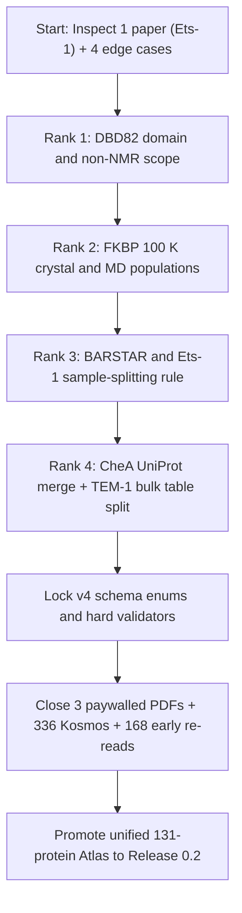

# Expert review guide (15 minutes)

This guide is for NMR specialist review before we run our `v4` schema sweep. Release `0.1` (`42` proteins) had dual review, while all new `v3` extraction rows still need expert sign-off. We already fixed the concrete data bugs we found (`BARSTAR` sample split, `5687` ID fix, controlled method groups, and building all `131` protein pages in [`atlas/ATLAS_131.md`](atlas/ATLAS_131.md)). Now we need your ruling on two things: whether our extraction logic is sound, and how to settle four scientific boundary rules.

---

## How your 4 decisions unlock `v4`

---

## 1. Is our paper-reading and verification logic reasonable?

After our October 22 meeting, we split **source-grounded extraction** from **protein-level synthesis**:

1. Read each full-text paper into a fixed template (`samples`, `methods`, one printed number per row, conformational PDB states, named dynamic regions, and figure-only gaps).
2. Run Python checks confirming every quote matches the paper text character for character, every number sits inside its quote, and no numeric table was skipped silently.
3. Send stratified subsets to an independent second model family (`Claude`, `GPT`, or `Gemini`) to catch missed values and boundary disputes.
4. Synthesize verified paper records into one page per protein ([`atlas/ATLAS_131.md`](atlas/ATLAS_131.md)) linked to deposited PDB structures and raw BMRB tables.

**Where automated checks stop.** Deterministic checks catch fabricated numbers and dropped tables (`776 / 776` records pass). They do **not** catch physical attribution errors when both strings appear in the same paper. For example, our earlier Barstar record merged HyperW NMR (`pD 7, ~1.8% H2O`) with CLEANEX NMR (`pH 7, 90% H2O`) into one sample card `S1`. We fixed that Barstar record on November 19, and [`methods/bugs_and_fixes.md`](methods/bugs_and_fixes.md) documents all five failure classes along with the code gates planned for `v4`.

**Question 1 for you.** Does reading one paper at a time into separated `samples`, `measurements`, `states`, `residue sets`, and `gaps`, followed by second-model spot checks, match how you would audit automated extraction? What single physical safeguard are we still missing?

---

## 2. Check one full paper from text to table

Before judging aggregate tables, inspect one complete paper end to end to check whether any step misreads the science.

Open **[`atlas/walkthrough_ets1.md`](atlas/walkthrough_ets1.md)** (murine Ets-1, *Biochemistry* 2016, [`doi:10.1021/acs.biochem.6b00460`](https://doi.org/10.1021/acs.biochem.6b00460)). It shows the exact quotes, all 4 sample blocks, all 12 rows (including `14.8 ns` caught only on blind second reading), all 5 PDB states, and intentional exclusions (`9.7 ns` cited from reference 11; DNA sequences in Table 1). Please check 3 small edge cases there:

1. Should qualitative prose bounds such as arginine `heteronuclear NOE < 0` stay as minor rows or move to qualitative region tags?
2. Must two temperatures in the same paper (`31 °C` backbone amides and `13 °C` arginine side chains) always split into two sample IDs when buffer and construct match?
3. When a paper prints conflicting DNA lengths (`DNASP12` in Results vs `DNASP14` in Methods for `ΔN279`), is keeping both strings in the sample note enough?

---

## 3. Judge four worked protein cases (ranked from most uncertain to clearest)

All `131` open proteins now have individual pages in [`atlas/ATLAS_131.md`](atlas/ATLAS_131.md), and the workbook holds `19,989` lossless rows (`575` exchange highlights). Below are the 4 deep worked cases ([`atlas/v3_previews/`](atlas/v3_previews/README.md)) ordered by how uncertain we are about the right scientific rule.

### Rank 1 (most uncertain). Domain and method boundaries in [`DBD82.md`](atlas/v3_previews/DBD82.md)

Across `23` papers for Glucocorticoid receptor (`DBD82`, `UniProt P06536`), only two NMR studies print exchange rates. Those two papers measure **different domains in different species**: rat DNA-binding domain (`DBD`) `Gly470` ZZ-exchange (`4.36` and `3.10 s−1`) versus human ligand-binding domain (`LBD`) CPMG dispersion (`kex = 1147 ± 82 s−1`, `pm = 19 ± 7%`). Four non-NMR papers add atomistic MD cluster overlaps, live-cell FCS diffusion times (`1.0` and `1.8 ms`), EMSA DNA dissociation half-lives (`0.56` to `2.33 min`), and cell-FRET monomer fractions.

**What we ask you.**
- When an entry name targets one domain (`DBD82`, `CHEAYBD`), should papers on another domain (`LBD`) be excluded, tagged separately, or merged under canonical full-length `UniProt` with a required `domain` column?
- Your September 29 Slack list included MD, FRET, and EPR/DEER. Cell-imaging FCS and EMSA DNA off-rates look like intermolecular kinetics or diffusion rather than conformational exchange. Where should we draw the hard inclusion line?

### Rank 2. Crystal dual conformers and MD alongside solution NMR in [`FKBP.md`](atlas/v3_previews/FKBP.md)

Human FKBP12 (`30` papers, `391` raw rows) spans five measurement types. Solution NMR contributes `331` fast ps-ns backbone rows (`303 K, 500 MHz`), `Trp59` ns ring reorientation (`80% / 20%` NOE admixture), slow `Gly89` cis-trans isomerization (`pB = 12%` WT at `25 °C`, `67%` in `G89A`, lifetimes `3.0 s` and `1.8 s`), and HDX reactivity (`pT(G89A) = 3.7%` across `β4-β5`). Non-NMR sources add `15` CHARMM27 MD rows (`7.9%` vs `59.6%`) and `3` cryo-X-ray (`100 K`) alternate occupancies (`Trp59` `0.29 / 0.71` in `4N19`).

**What we ask you.** We already split `MD` and `cryo-X-ray` into Section 3 of every protein page and into their own `row_tier` in Excel. Please confirm keeping `100 K` crystal occupancies and MD populations permanently outside experimental solution-exchange counts.

### Rank 3. Sample-splitting threshold in [`16392_and_BARSTAR.md`](atlas/v3_previews/16392_and_BARSTAR.md) (Part B)

In Barstar (`10.1021/jacs.0c00807`), the authors ran HyperW NMR at `50 °C` in `pD 7` (`~1.8% H2O` post-injection), lyophilized the sample, and dissolved it in `90% H2O` (`pH 7`) for CLEANEX. Our original sample card blended both experiments into `S1`. We split `S1` into `S1` (HyperW) and `S2` (CLEANEX) on November 19.

**What we ask you.** Confirm that our `v4` schema should require a separate `sample` record whenever solvent isotopic composition (`% H2O` vs `% D2O`), `pH/pD`, temperature, or ligand ratio changes between measurements.

### Rank 4 (layout and deduplication choice). Duplicate entries and bulk SI tables

- **Duplicate entries ([`CHEA_CHEAYBD.md`](atlas/v3_previews/CHEA_CHEAYBD.md)).** RelaxDB filed *E. coli* CheA (`P07363`) under both `CHEA` and `CHEAYBD`. Extracting both separately caused `11` vs `37` row divergence on the same HDX-MS paper, conflicting `homolog` tags, and missing backbone data (`1,052` rows in `CHEA` absent from `CHEAYBD`). Six other UniProt pairs exist across the dataset. Confirm indexing `v4` once per canonical `UniProt` ID while preserving domain tags.
- **Bulk relaxation vs exchange kinetics ([`16392_and_BARSTAR.md`](atlas/v3_previews/16392_and_BARSTAR.md), Part A).** In TEM-1 (`16392`), `1,879` per-residue SI spin-relaxation rows (offset `+25` from Ambler numbering) visually bury `4` Ω-loop CEST rows (`1.05%, 98 s−1`) and `13` `G238S` CPMG dispersion rows. We already separated them in `Exchange_Highlights` and `ATLAS_131.md`. Confirm keeping bulk per-residue `R1/R2/NOE/S2` lists separate from mechanistic exchange tables in future releases.

---

## Supporting architecture and bug records

For our 7-step architecture and comparison with Bindwell, Elicit, and PaperQA/Kosmos, read [`methods/how_it_is_built.md`](methods/how_it_is_built.md). For concrete failure modes already fixed vs queued for `v4`, read [`methods/bugs_and_fixes.md`](methods/bugs_and_fixes.md).
