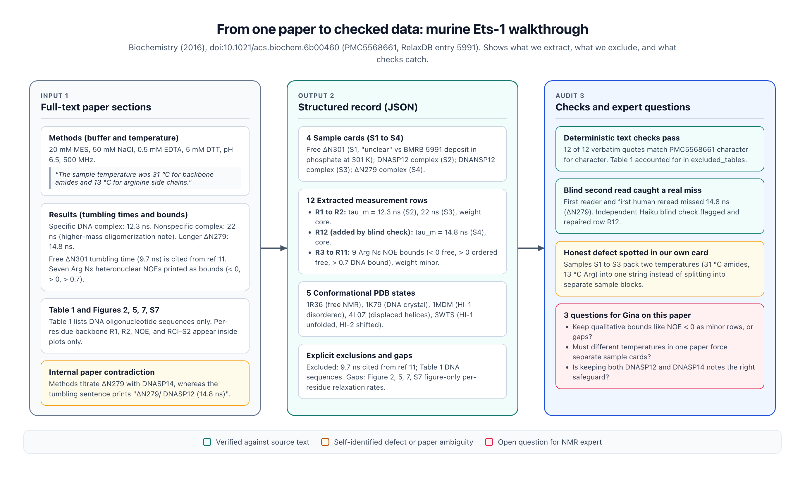

# Expert review guide (15 minutes)

This guide is for NMR scientist review before we run our next full literature sweep. Nothing in the recent extraction draft has been signed off by an NMR specialist yet. We need your judgment on two questions. Is our paper-reading and verification logic scientifically sound, and how should we rule on four borderline protein cases?

---

## 1. Is our paper-reading and verification logic reasonable?

Following our team agreement after the October 22 meeting, we separate **source-grounded extraction** from **protein-level synthesis**:

1. Read each full-text paper into a fixed template (`samples`, `methods`, `one printed number per row`, `conformational PDB states`, `named dynamic regions`, and `figure-only gaps`).
2. Run Python checks confirming that every quote matches the paper text character for character, every number sits inside its quote, and no numeric table was skipped silently.
3. Send stratified subsets to an independent second model family (Claude, GPT, or Gemini depending on batch) to catch missed values and scope boundary disputes.
4. Aggregate the verified paper records back into per-protein summaries linked to deposited PDB structures and raw BMRB tables.

**Where automated checks stop.** Deterministic checks catch fabricated numbers and dropped tables (`771 / 771` records pass). They do **not** catch subtle physical attribution errors where both strings appear in the same paper. For example, our Barstar check failed to notice that one sample card combined HyperW NMR (`pD 7, ~1.8% H2O`) with CLEANEX NMR (`pH 7, 90% H2O`). See [`methods/bugs_and_fixes.md`](methods/bugs_and_fixes.md) for all four failure classes we found ourselves.

**First question for you.** Setting aside the spreadsheet format, does reading one paper at a time into separated `samples`, `measurements`, `states`, `residue sets`, and `explicit gaps`, followed by independent second-model spot checks, match how you would audit automated extraction? What single physical safeguard are we still missing?

---

## 2. Check one full paper from text to table

Before judging aggregate numbers, inspect one complete paper end to end so you can tell us whether any step misreads the science.

Open **[`atlas/walkthrough_ets1.md`](atlas/walkthrough_ets1.md)** (murine Ets-1, *Biochemistry* 2016, [`doi:10.1021/acs.biochem.6b00460`](https://doi.org/10.1021/acs.biochem.6b00460)). It shows the exact paper quotes, all 4 sample blocks, all 12 rows (including `14.8 ns` caught only on blind second reading), all 5 PDB states, what was intentionally excluded (`9.7 ns` cited from reference 11; DNA sequences in Table 1), and 3 concrete ambiguities we ask you to settle:

1. Should qualitative prose bounds such as arginine `heteronuclear NOE < 0` stay as minor rows or move to qualitative region tags?
2. Must two temperatures in the same paper (`31 °C` backbone amides and `13 °C` arginine side chains) always split into two sample IDs, even when buffer and construct stay identical?
3. When a paper prints conflicting DNA lengths (`DNASP12` in Results vs `DNASP14` in Methods for `ΔN279`), is keeping both strings in the sample note enough?

---

## 3. Judge four worked protein cases (ordered from most uncertain to clear structural choice)

Because a `19,958`-row spreadsheet hides scientific structure, we translated 4 representative proteins into readable synthesis pages. They are ranked below by how uncertain we are about the right scientific rule.

### Rank 1 (most uncertain). Domain and method boundaries in [`DBD82.md`](atlas/v3_previews/DBD82.md)

Across `23` papers for Glucocorticoid receptor (`DBD82`, `UniProt P06536`), only two NMR relaxation studies print exchange rates, and they measure **different domains in different species**: rat DNA-binding domain (`DBD`) `Gly470` ZZ-exchange (`4.36` and `3.10 s−1`) versus human ligand-binding domain (`LBD`) CPMG dispersion (`kex = 1147 ± 82 s−1`, `pm = 19 ± 7%`). Four non-NMR papers contribute atomistic MD cluster overlaps, live-cell FCS diffusion times (`1.0` and `1.8 ms`), EMSA DNA dissociation half-lives (`0.56` to `2.33 min`), and cell-FRET monomer fractions.

**What we ask you.**
- When an entry name targets a specific domain (`DBD82`, `CHEAYBD`), should papers measuring another domain (`LBD`) be excluded, tagged separately, or unified under canonical full-length `UniProt` with a required `domain` column?
- On your September 29 Slack list, MD, FRET, and EPR/DEER belonged in scope, whereas cell imaging FCS and EMSA DNA off-rates look like intermolecular kinetics or diffusion rather than intramolecular conformational exchange. Where should we draw the hard inclusion line?

### Rank 2. Crystal dual conformers and MD alongside solution NMR in [`FKBP.md`](atlas/v3_previews/FKBP.md)

Human FKBP12 (`30` papers, `391` raw rows) brings together fast ps–ns backbone relaxation (`331` rows at `303 K, 500 MHz`), `Trp59` ns ring reorientation (`80% / 20%` NOE admixture fit), slow `Gly89` cis–trans isomerization (`pB = 12%` WT at `25 °C`, `67%` in `G89A`, `zz-exchange` lifetimes `3.0 s` and `1.8 s`), hydrogen exchange reactivity (`pT(G89A) = 3.7%` across the `β4–β5` loop), `15` CHARMM27 MD rows (`7.9%` vs `59.6%`), and `3` cryo-X-ray (`100 K`) alternate occupancies (`Trp59` `0.29 / 0.71` in `4N19`).

**What we ask you.** Should `100 K` crystal dual-conformer occupancies and `MD` state percentages sit strictly in separate computational or structural tables rather than appearing in experimental population counts?

### Rank 3. Sample-splitting threshold in [`16392_and_BARSTAR.md`](atlas/v3_previews/16392_and_BARSTAR.md) (Part B)

In Barstar (`10.1021/jacs.0c00807`), the authors ran HyperW NMR at `50 °C` in `pD 7` (`~1.8% H2O` after injection), lyophilized the sample, and dissolved it in `90% H2O` (`pH 7`) for CLEANEX. Our sample record blended both conditions into one entry (`S1`).

**What we ask you.** Confirm that our next schema must force a separate `sample` record whenever solvent isotopic composition (`% H2O` vs `% D2O`), `pH/pD`, temperature, or ligand ratio changes between two measurements in the same paper.

### Rank 4 (layout and deduplication choice). Duplicate entries and bulk SI tables

- **Duplicate entries ([`CHEA_CHEAYBD.md`](atlas/v3_previews/CHEA_CHEAYBD.md)).** RelaxDB filed *E. coli* CheA (`P07363`) under both `CHEA` and `CHEAYBD`, causing `11` vs `37` row divergence on the same HDX-MS paper, conflicting `homolog` tags, and missing backbone data (`1,052` rows in `CHEA` absent from `CHEAYBD`). Four other twin UniProt pairs exist in the dataset (`BLAC_CPMG`/`27888`, `AQADK`/`AQADK_CPMG`, `ARGKIN`/`ARGKIN_CPMG`, `HTPDZ`/`HTPDZ_CPMG`). Confirm merging extraction and synthesis per canonical `UniProt` ID while preserving domain tags.
- **Bulk relaxation vs exchange kinetics ([`16392_and_BARSTAR.md`](atlas/v3_previews/16392_and_BARSTAR.md), Part A).** In TEM-1 (`16392`), `1,879` per-residue SI spin-relaxation rows (with residue offset `+25` relative to Ambler numbering) visually bury `4` Ω-loop CEST rows (`1.05%, 98 s−1`) and `13` `G238S` CPMG dispersion rows. Should future releases split per-residue `R1/R2/NOE/S2` lists from mechanistic exchange-process tables?

---

## How our architecture and bugs tie together

For how our 7-step design combines Astra's deterministic pipeline, Bindwell's per-paper rubric evaluation, Elicit-style cited tables, and published NLP safeguards, read [`methods/how_it_is_built.md`](methods/how_it_is_built.md). For concrete failure modes we caught before asking you to scale, read [`methods/bugs_and_fixes.md`](methods/bugs_and_fixes.md).
