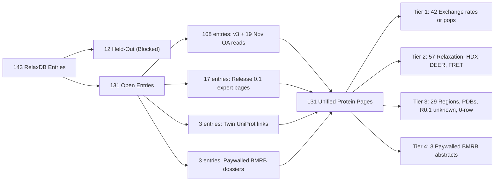

# Dynamics Atlas: Complete 131-Protein Directory (Unified Draft)

Every open RelaxDB protein (`131 / 131`) now has a dedicated protein-level page in [`atlas/all_proteins/`](all_proteins/16392.md). The `12` held-out benchmark entries remain physically excluded. This directory unifies **Release `0.1` (`42` expert-reviewed proteins)**, **`v3` full-text extraction (`104` entries)**, and our **`2026-11-19` bug fixes and open-access reads (`15451`, `5841`, `5687`, `CMTIV`, `7432`, plus `BARSTAR` `S1`/`S2` split)**.

| Coverage summary | Entries | Notes |
|---|---:|---|
| **Tier 1 · Experimental exchange rates or populations** | **42** | `kex`, `kAB/kBA`, `kopen/kclose`, `pB`, `population`, or `Δω` (MD and cryo-X-ray kept separate) |
| **Tier 2 · Quantitative relaxation / HDX / DEER / FRET or exchange detected** | **57** | `R1/R2/NOE/S2/τe/τm/Rex`, HDX, DEER, FRET, or Release `0.1` `possible` |
| **Tier 3 · Qualitative regions / PDB states / Release `0.1` `unknown` / twin link / 0-numeric full text** | **29** | Full text read cleanly (or covered via twin UniProt / Release `0.1`); no printed rates |
| **Tier 4 · Paywalled BMRB source paper** | **3** | Exact BMRB metadata, primary DOI/PMID, and PubMed abstract logged (`15795`, `18477`, `50734`) |
| **Total open RelaxDB entries** | **131** | `128 / 131` (`97.7%`) with full-text coverage or twin UniProt; `3 / 131` paywalled source dossiers |

## Tier 1. Experimental conformational exchange rates or populations

| Entry | Protein | UniProt | Release 0.1 | v3 papers | Exch. rows | Total rows | PDBs | Notes |
|---|---|---|---|---:|---:|---:|---:|---|
| [`ARGKIN`](all_proteins/ARGKIN.md) | Arginine Kinase | `P51541` |  | 1 | 131 | 162 | 1 | Twin UniProt P51541 (Release 0.1 page under ARGKIN_CPMG) |
| [`AQADK_CPMG`](all_proteins/AQADK_CPMG.md) | AqAdK | `O66490` | [`possible`](proteins/AQADK_CPMG.md) | 1 | 63 | 65 | 2 | Twin UniProt O66490 (shared with AQADK) |
| [`6470`](all_proteins/6470.md) | Ubiquitin-ribosomal protein eL40 fusio | `P62987` |  | 39 | 50 | 188 | 50 |  |
| [`17881`](all_proteins/17881.md) | Calmodulin 1 | `P62157` |  | 46 | 43 | 139 | 50 |  |
| [`7432`](all_proteins/7432.md) | Iron-sulfur cluster assembly scaffold  | `P0ACD4` |  | 12 | 30 | 50 | 8 | ENRICHED 2026-11-19: added PNAS 2011 ZZ-exchange rates (PMC3258623, 0.77/2. |
| [`51230`](all_proteins/51230.md) | Subtilisin-chymotrypsin inhibitor-2A | `P01053` |  | 11 | 20 | 138 | 5 |  |
| [`50233`](all_proteins/50233.md) | RISC-loading complex subunit TARBP2 | `Q15633` |  | 14 | 20 | 49 | 7 |  |
| [`ATS`](all_proteins/ATS.md) | Tryptophan synthase alpha chain | `P00929` |  | 14 | 20 | 23 | 31 |  |
| [`51416`](all_proteins/51416.md) | Bromodomain-containing protein 4 | `O60885` |  | 67 | 16 | 126 | 113 |  |
| [`CYPA_CPMG`](all_proteins/CYPA_CPMG.md) | CypA | `P62937` | [`yes`](proteins/CYPA_CPMG.md) | 1 | 16 | 21 | 1 |  |
| [`FKBP`](all_proteins/FKBP.md) | Peptidyl-prolyl cis-trans isomerase FK | `P62942` |  | 30 | 12 | 391 | 34 | [Deep review](v3_previews/FKBP.md) · Review case (Rank 2): NMR exchange + 15 MD rows + 3 cryo-X-ray (100 K) rows |
| [`27888`](all_proteins/27888.md) | Beta-lactamase | `P9WKD3` |  | 27 | 12 | 27 | 39 | Twin UniProt P9WKD3 (Release 0.1 page under BLAC_CPMG) |
| [`CDK3`](all_proteins/CDK3.md) | Calcium-dependent protein kinase 3 | `Q9NJU9` |  | 1 | 12 | 16 | 1 |  |
| [`BPTI`](all_proteins/BPTI.md) | Pancreatic trypsin inhibitor | `P00974` |  | 7 | 10 | 40 | 3 |  |
| [`16392`](all_proteins/16392.md) | TEM1 beta lactamase | `P62594` |  | 18 | 9 | 1912 | 20 | [Deep review](v3_previews/16392_and_BARSTAR.md) · Review case (Rank 4): 1,879 SI bulk rows vs 17 exchange rows; +25 numbering |
| [`MFDTD`](all_proteins/MFDTD.md) | Transcription-repair-coupling factor | `P30958` |  | 14 | 8 | 28 | 11 |  |
| [`DBD82`](all_proteins/DBD82.md) | Glucocorticoid receptor | `P06536` |  | 23 | 8 | 19 | 20 | [Deep review](v3_previews/DBD82.md) · Review case (Rank 1): mixes rat DBD & human LBD + MD/FCS/EMSA/FRET rows |
| [`MK12`](all_proteins/MK12.md) | Mitogen-activated protein kinase 12 | `P53778` |  | 5 | 7 | 52 | 2 |  |
| [`HTPDZ`](all_proteins/HTPDZ.md) | Serine protease HTRA2, mitochondrial | `O43464` |  | 1 | 7 | 30 | 3 | Twin UniProt O43464 (Release 0.1 page under HTPDZ_CPMG) |
| [`CHEA`](all_proteins/CHEA.md) | Chemotaxis protein CheA | `P07363` |  | 23 | 6 | 1097 | 10 | [Deep review](v3_previews/CHEA_CHEAYBD.md) · Review case (Rank 4): duplicate UniProt P07363 with CHEAYBD (cross-linked i |
| [`CSPA`](all_proteins/CSPA.md) | Cold shock protein CspA | `P0A9X9` |  | 6 | 6 | 352 | 3 |  |
| [`AZURIN`](all_proteins/AZURIN.md) | Azurin | `P00282` | [`yes`](proteins/AZURIN.md) | 1 | 6 | 31 | 0 |  |
| [`CHEAYBD`](all_proteins/CHEAYBD.md) | Chemotaxis protein CheA | `P07363` |  | 18 | 5 | 75 | 9 | [Deep review](v3_previews/CHEA_CHEAYBD.md) · Review case (Rank 4): duplicate UniProt P07363 with CHEA (cross-linked in A |
| [`7056`](all_proteins/7056.md) | Polymerase basic protein 2 | `P31345` |  | 24 | 4 | 7 | 28 |  |
| [`BARSTAR`](all_proteins/BARSTAR.md) | Barstar | `P11540` |  | 8 | 4 | 7 | 3 | [Deep review](v3_previews/16392_and_BARSTAR.md) · FIXED 2026-11-19: jacs.0c00807 S1 split into S1 (HyperW pD 7) & S2 (CLEANEX |
| [`27011`](all_proteins/27011.md) | RNA polymerase sigma factor SigA | `P06224` | [`yes`](proteins/27011.md) | 1 | 3 | 10 | 2 |  |
| [`GXN`](all_proteins/GXN.md) | Glutaredoxin 1 | `P68688` |  | 1 | 2 | 999 | 0 |  |
| [`26513`](all_proteins/26513.md) | Tyrosine-Phosphatase A | `P9WIA1` |  | 6 | 2 | 15 | 2 |  |
| [`CRABP2`](all_proteins/CRABP2.md) | Cellular retinoic acid-binding protein | `P29373` | [`yes`](proteins/CRABP2.md) | 1 | 2 | 14 | 2 |  |
| [`IL1B`](all_proteins/IL1B.md) | Interleukin-1 beta (IL-1b) | `P01584` |  | 10 | 2 | 12 | 3 |  |
| [`18092`](all_proteins/18092.md) | Eukaryotic release factor 1 | `P03355` | [`yes`](proteins/18092.md) | 1 | 2 | 7 | 0 |  |
| [`PLEXINB1`](all_proteins/PLEXINB1.md) | Plexin-B1 | `O43157` |  | 5 | 1 | 2157 | 4 |  |
| [`EGLC`](all_proteins/EGLC.md) | Eglin C | `P01051` |  | 3 | 1 | 18 | 1 |  |
| [`ISDHN2`](all_proteins/ISDHN2.md) | Iron-regulated surface determinant pro | `Q2FG07` |  | 5 | 1 | 8 | 3 |  |
| [`4762`](all_proteins/4762.md) | Nitrogen regulation protein (NtrC) | `P41789` | [`yes`](proteins/4762.md) | 0 | 0 | 0 | 0 |  |
| [`ARGKIN_CPMG`](all_proteins/ARGKIN_CPMG.md) | Arginine Kinase | `P51541` | [`yes`](proteins/ARGKIN_CPMG.md) | 0 | 0 | 0 | 0 | Twin UniProt P51541 (Release 0.1 page; v3 read under ARGKIN) |
| [`BLVRB_CPMG`](all_proteins/BLVRB_CPMG.md) | BLVRB | `P30043` | [`yes`](proteins/BLVRB_CPMG.md) | 0 | 0 | 0 | 0 |  |
| [`HTPDZ_CPMG`](all_proteins/HTPDZ_CPMG.md) | Serine protease HTRA2, mitochondrial | `O43464` | [`yes`](proteins/HTPDZ_CPMG.md) | 0 | 0 | 0 | 0 | Twin UniProt O43464 (Release 0.1 page; v3 read under HTPDZ) |
| [`KRAS_CPMG`](all_proteins/KRAS_CPMG.md) | K-Ras4B | `P01116` | [`yes`](proteins/KRAS_CPMG.md) | 0 | 0 | 0 | 0 |  |
| [`RFAHTD`](all_proteins/RFAHTD.md) | Transcription antitermination protein  | `P0AFW0` | [`yes`](proteins/RFAHTD.md) | 0 | 0 | 0 | 0 |  |
| [`RNASE_CPMG`](all_proteins/RNASE_CPMG.md) | RNase A | `P61824` | [`yes`](proteins/RNASE_CPMG.md) | 0 | 0 | 0 | 0 |  |
| [`VHR_CPMG`](all_proteins/VHR_CPMG.md) | VHR (PTP) | `P51452` | [`yes`](proteins/VHR_CPMG.md) | 0 | 0 | 0 | 0 |  |

## Tier 2. Quantitative relaxation, HDX, DEER, FRET, or exchange detected

| Entry | Protein | UniProt | Release 0.1 | v3 papers | Exch. rows | Total rows | PDBs | Notes |
|---|---|---|---|---:|---:|---:|---:|---|
| [`6838`](all_proteins/6838.md) | Beta-lactamase PSE-4 | `P16897` | [`possible`](proteins/6838.md) | 1 | 0 | 3024 | 0 |  |
| [`VCPTH`](all_proteins/VCPTH.md) | Peptidyl-tRNA hydrolase | `P0A7D1` | [`possible`](proteins/VCPTH.md) | 1 | 0 | 1310 | 3 |  |
| [`OMP`](all_proteins/OMP.md) | Olfactory marker protein | `P08523` |  | 1 | 0 | 1051 | 0 |  |
| [`FSIB`](all_proteins/FSIB.md) | Fibroblast growth factor 8 | `P55075` |  | 1 | 0 | 952 | 1 |  |
| [`CD9K`](all_proteins/CD9K.md) | S100 calcium-binding protein G | `P02633` | [`possible`](proteins/CD9K.md) | 1 | 0 | 801 | 0 |  |
| [`15255`](all_proteins/15255.md) | Diphtheria toxin repressor | `P0DJL7` |  | 1 | 0 | 756 | 2 |  |
| [`IL4`](all_proteins/IL4.md) | Interleukin-4 (IL-4) | `P05112` |  | 10 | 0 | 729 | 4 |  |
| [`LYSZ`](all_proteins/LYSZ.md) | Lysozyme C | `P00698` |  | 44 | 0 | 661 | 20 |  |
| [`HGMCSF`](all_proteins/HGMCSF.md) | Granulocyte-macrophage colony-stimulat | `P09919` |  | 15 | 0 | 654 | 1 | Card mismatch: labeled GM-CSF, but UniProt P09919 & papers are G-CSF |
| [`5518`](all_proteins/5518.md) | Ovomucoid | `P68436` |  | 2 | 0 | 496 | 0 |  |
| [`ATFKR`](all_proteins/ATFKR.md) | Urokinase-type plasminogen activator,  | `P00749` |  | 6 | 0 | 451 | 2 |  |
| [`HTGFA`](all_proteins/HTGFA.md) | Protransforming growth factor alpha | `P01135` | [`possible`](proteins/HTGFA.md) | 1 | 0 | 229 | 0 |  |
| [`IRSPTB`](all_proteins/IRSPTB.md) | Insulin receptor substrate 1 | `P35568` |  | 5 | 0 | 91 | 5 |  |
| [`IFNAR2`](all_proteins/IFNAR2.md) | Interferon alpha/beta receptor 2 | `P48551` |  | 5 | 0 | 82 | 3 |  |
| [`GPIIA`](all_proteins/GPIIA.md) | PTS system glucose-specific EIICBA com | `P20166` |  | 2 | 0 | 43 | 0 |  |
| [`TRX`](all_proteins/TRX.md) | Thioredoxin 1 | `P0AA29` | [`possible`](proteins/TRX.md) | 1 | 0 | 38 | 0 |  |
| [`PI3KSH2`](all_proteins/PI3KSH2.md) | PI3-kinase regulatory alpha subunit | `P27986` |  | 10 | 0 | 33 | 9 |  |
| [`5991`](all_proteins/5991.md) | p54 | `P27577` |  | 15 | 0 | 30 | 11 | [Deep review](walkthrough_ets1.md) · Walkthrough entry + card mismatch: mouse Ets-1 (P27577); human ETS1 tagged  |
| [`18260`](all_proteins/18260.md) | Spectrin alpha chain | `P07751` |  | 3 | 0 | 24 | 8 |  |
| [`VMIPII`](all_proteins/VMIPII.md) | Viral macrophage inflammatory protein  | `Q98157` |  | 10 | 0 | 24 | 3 |  |
| [`11080`](all_proteins/11080.md) | peptidylprolyl isomerase | `O74049` |  | 1 | 0 | 22 | 1 |  |
| [`UVRDTD`](all_proteins/UVRDTD.md) | DNA helicase II (UrvD domain) | `P03018` |  | 9 | 0 | 21 | 7 |  |
| [`5995`](all_proteins/5995.md) | Major urinary protein 1 | `P11588` |  | 2 | 0 | 17 | 0 |  |
| [`5841`](all_proteins/5841.md) | Kinase associated protein phosphatase | `P46014` |  | 1 | 0 | 16 | 1 | NEW 2026-11-19: read BMRB 5841 full text (PMC2813517, 1MZK, S2/tau_m/Rex) |
| [`25013`](all_proteins/25013.md) | Flavodoxin YqcA | `P65367` |  | 1 | 0 | 15 | 2 |  |
| [`BINASE`](all_proteins/BINASE.md) | Ribonuclease | `P00648` |  | 1 | 0 | 14 | 0 |  |
| [`19127`](all_proteins/19127.md) | Endolysin | `P03706` |  | 3 | 0 | 13 | 2 |  |
| [`CBFB`](all_proteins/CBFB.md) | Core-binding factor subunit beta | `Q08024` |  | 8 | 0 | 11 | 7 |  |
| [`ACBP`](all_proteins/ACBP.md) | Acyl-CoA-binding protein | `P07107` |  | 2 | 0 | 10 | 1 |  |
| [`5839`](all_proteins/5839.md) | Immunoglobulin G-binding protein G | `P06654` | [`possible`](proteins/5839.md) | 1 | 0 | 9 | 0 |  |
| [`SPOOF`](all_proteins/SPOOF.md) | Sporulation initiation phosphotransfer | `P06628` |  | 4 | 0 | 9 | 8 |  |
| [`PCF11`](all_proteins/PCF11.md) | Protein PCF11 second N-terminal domain | `P39081` |  | 8 | 0 | 8 | 2 |  |
| [`18772`](all_proteins/18772.md) | Staphylococcal complement inhibitor | `Q6GFB4` |  | 4 | 0 | 6 | 1 |  |
| [`7036`](all_proteins/7036.md) | Cytoplasmic protein NCK2 | `O43639` | [`unknown`](proteins/7036.md) | 1 | 0 | 6 | 3 |  |
| [`CMTIV`](all_proteins/CMTIV.md) | Inhibitor of trypsin and hageman facto | `P19873` |  | 1 | 0 | 6 | 0 | NEW 2026-11-19: PMC2143810 abstract_only S2 + PMC2249841 full text (1996 pa |
| [`17266`](all_proteins/17266.md) | Silver efflux protein | `Q58AF3` | [`possible`](proteins/17266.md) | 1 | 0 | 5 | 1 |  |
| [`50410`](all_proteins/50410.md) | All4940 protein | `Q8YMJ3` | [`possible`](proteins/50410.md) | 1 | 0 | 5 | 1 |  |
| [`CDNFSP`](all_proteins/CDNFSP.md) | Cerebral dopamine neurotrophic factor, | `Q49AH0` |  | 7 | 0 | 5 | 2 |  |
| [`17246`](all_proteins/17246.md) | Cell wall surface anchor family protei | `A0A0H2UNM7` |  | 3 | 0 | 4 | 0 |  |
| [`4689`](all_proteins/4689.md) | Somatotropin | `P01241` |  | 8 | 0 | 4 | 0 |  |
| [`SAV`](all_proteins/SAV.md) | Subtilisin Savinase | `P29600` |  | 1 | 0 | 4 | 0 |  |
| [`18380`](all_proteins/18380.md) | Cytochrome c-type biogenesis protein C | `Q72D78` |  | 1 | 0 | 3 | 1 |  |
| [`50332`](all_proteins/50332.md) | Iron-compound ABC transporter | `x` |  | 2 | 0 | 2 | 1 | Placeholder UniProt 'x': distinct from 5687 |
| [`DR1885`](all_proteins/DR1885.md) | Copper chaperone PCu(A)C | `Q9RT80` |  | 1 | 0 | 2 | 0 |  |
| [`15451`](all_proteins/15451.md) | GA-binding protein alpha chain | `Q00422` |  | 1 | 0 | 1 | 1 | NEW 2026-11-19: read BMRB 15451 full text (PMC2486348, 2JUO, tau_c 5.9 ns) |
| [`17783`](all_proteins/17783.md) | Protein damX | `P11557` |  | 4 | 0 | 1 | 0 |  |
| [`18306`](all_proteins/18306.md) | C->U-editing enzyme APOBEC-2 | `Q9Y235` | [`unknown`](proteins/18306.md) | 1 | 0 | 1 | 0 |  |
| [`30523`](all_proteins/30523.md) | Cell division protein FtsX | `Q04LE4` |  | 5 | 0 | 1 | 4 |  |
| [`ACRIIA4`](all_proteins/ACRIIA4.md) | anti-CRISPR protein AcrIIA4 | `A0A247D711` |  | 4 | 0 | 1 | 3 |  |
| [`MIA40`](all_proteins/MIA40.md) | Mitochondrial intermembrane space impo | `Q8N4Q1` | [`unknown`](proteins/MIA40.md) | 1 | 0 | 1 | 1 |  |
| [`15521`](all_proteins/15521.md) | Thyroid TF 1 Homeodomain | `P23441` | [`possible`](proteins/15521.md) | 0 | 0 | 0 | 0 |  |
| [`BLAC_CPMG`](all_proteins/BLAC_CPMG.md) | BLAC | `P9WKD3` | [`possible`](proteins/BLAC_CPMG.md) | 0 | 0 | 0 | 0 | Twin UniProt P9WKD3 (Release 0.1 page; v3 read under 27888) |
| [`CHEY_CPMG`](all_proteins/CHEY_CPMG.md) | CheY | `P0AE67` | [`possible`](proteins/CHEY_CPMG.md) | 0 | 0 | 0 | 0 |  |
| [`CXCL8`](all_proteins/CXCL8.md) | Interleukin-8 | `P10145` | [`possible`](proteins/CXCL8.md) | 0 | 0 | 0 | 0 |  |
| [`REV1CT`](all_proteins/REV1CT.md) | DNA repair protein REV1 | `Q9UBZ9` | [`possible`](proteins/REV1CT.md) | 0 | 0 | 0 | 0 |  |
| [`SPRY`](all_proteins/SPRY.md) | SPRY domain-containing SOCS box protei | `O88838` | [`possible`](proteins/SPRY.md) | 1 | 0 | 0 | 1 |  |
| [`VL`](all_proteins/VL.md) | Ig kappa chain V-II region 26-10 | `P01631` | [`possible`](proteins/VL.md) | 0 | 0 | 0 | 0 |  |

## Tier 3. Qualitative dynamic regions, PDB states, Release 0.1 unknown, twin links, or 0-numeric full text

| Entry | Protein | UniProt | Release 0.1 | v3 papers | Exch. rows | Total rows | PDBs | Notes |
|---|---|---|---|---:|---:|---:|---:|---|
| [`ORC2WH`](all_proteins/ORC2WH.md) | Origin recognition complex subunit 2 | `Q13416` |  | 4 | 0 | 2 | 3 |  |
| [`17018`](all_proteins/17018.md) | Death-associated protein 6 | `Q4VX54` |  | 14 | 0 | 0 | 6 |  |
| [`17306`](all_proteins/17306.md) | Consensus de novo ankryin protein | `N1S0H6` | [`unknown`](proteins/17306.md) | 1 | 0 | 0 | 1 |  |
| [`17701`](all_proteins/17701.md) | L,D-transpeptidase YkuD | `O34816` | [`unknown`](proteins/17701.md) | 0 | 0 | 0 | 0 |  |
| [`18257`](all_proteins/18257.md) | Tat proofreading chaperone DmsD | `P69853` |  | 3 | 0 | 0 | 2 |  |
| [`18758`](all_proteins/18758.md) | Ubiquitin activating enzyme E1 | `Q02053` |  | 5 | 0 | 0 | 3 |  |
| [`19153`](all_proteins/19153.md) | Cation-independent mannose-6-phosphate | `P11717` |  | 12 | 0 | 0 | 6 |  |
| [`19189`](all_proteins/19189.md) | Fatty acid-binding protein, liver | `P07148` |  | 10 | 0 | 0 | 7 |  |
| [`25636`](all_proteins/25636.md) | AVR-Pia | `B9WZW9` |  | 8 | 0 | 0 | 1 |  |
| [`26723`](all_proteins/26723.md) | 25 kDa calcium-binding protein | `P09226` |  | 2 | 0 | 0 | 0 |  |
| [`36171`](all_proteins/36171.md) | Pin-II type proteinase inhibitor 38 | `T1PZ86` |  | 1 | 0 | 0 | 0 |  |
| [`4267`](all_proteins/4267.md) | Neutrophil gelatinase-associated lipoc | `P80188` | [`unknown`](proteins/4267.md) | 0 | 0 | 0 | 0 |  |
| [`4390`](all_proteins/4390.md) | Eotaxin | `P51671` |  | 9 | 0 | 0 | 1 |  |
| [`50020`](all_proteins/50020.md) | Collagen alpha-1(VII) chain | `Q63870` | [`unknown`](proteins/50020.md) | 1 | 0 | 0 | 1 |  |
| [`5154`](all_proteins/5154.md) | Metalloproteinase inhibitor 1 | `P01033` |  | 8 | 0 | 0 | 2 |  |
| [`5687`](all_proteins/5687.md) | Four helix bundle | `x` |  | 1 | 0 | 0 | 1 | FIXED 2026-11-19: separated from 50332 ('x' bug) & read PNAS 2003 (1P68) |
| [`A3VI`](all_proteins/A3VI.md) | Collagen alpha-3(VI) chain | `P12111` |  | 7 | 0 | 0 | 0 |  |
| [`AQADK`](all_proteins/AQADK.md) | Adenylate kinase | `O66490` |  | 0 | 0 | 0 | 0 | Twin UniProt O66490 covered under AQADK_CPMG (Release 0.1 + v3) |
| [`BLOT5`](all_proteins/BLOT5.md) | Mite allergen Blo t 5 | `O96870` |  | 3 | 0 | 0 | 0 |  |
| [`CIN1D1`](all_proteins/CIN1D1.md) | Cellophane-induced protein 1, domain 1 | `A8W3P3` | [`unknown`](proteins/CIN1D1.md) | 0 | 0 | 0 | 0 |  |
| [`CIN1D2`](all_proteins/CIN1D2.md) | Cellophane-induced protein 1, domain 2 | `A8W3P3` |  | 0 | 0 | 0 | 0 | Twin UniProt A8W3P3 covered under CIN1D1 (Release 0.1) |
| [`IL13`](all_proteins/IL13.md) | Interleukin-13 | `P35225` |  | 4 | 0 | 0 | 3 |  |
| [`MERP`](all_proteins/MERP.md) | Mercuric transport protein periplasmic | `P04129` |  | 2 | 0 | 0 | 2 |  |
| [`MLC1PN`](all_proteins/MLC1PN.md) | Myosin light chain 1, N lobe | `P53141` |  | 1 | 0 | 0 | 0 |  |
| [`PSD1`](all_proteins/PSD1.md) | Defense-related peptide 1 | `P81929` |  | 3 | 0 | 0 | 0 |  |
| [`RNASE`](all_proteins/RNASE.md) | RNase A | `P61824` |  | 0 | 0 | 0 | 0 | Twin UniProt P61824 covered under RNASE_CPMG (Release 0.1) |
| [`SMNTD`](all_proteins/SMNTD.md) | Survival motor neuron protein | `Q16637` |  | 5 | 0 | 0 | 4 |  |
| [`TEPI`](all_proteins/TEPI.md) | Thioesterase 1 | `P0ADA1` |  | 2 | 0 | 0 | 1 |  |
| [`VILD6`](all_proteins/VILD6.md) | Villin-1 D6 domain | `P02640` | [`unknown`](proteins/VILD6.md) | 1 | 0 | 0 | 0 |  |

## Tier 4. Paywalled BMRB source papers (3 entries)

| Entry | Protein | UniProt | Release 0.1 | v3 papers | Exch. rows | Total rows | PDBs | Notes |
|---|---|---|---|---:|---:|---:|---:|---|
| [`15795`](all_proteins/15795.md) | MBF1 of Trichoderma reesei | `G0RLX7` |  | 0 | 0 | 0 | 0 | Paywalled BMRB source (doi:10.1002/prot.22344, PMID 19137618); dossier logg |
| [`18477`](all_proteins/18477.md) | Dolichyl-phosphooligosaccharide-protei | `O30195` |  | 0 | 0 | 0 | 0 | Paywalled BMRB source (doi:10.1016/j.str.2012.10.011, PMID 23177926); abstr |
| [`50734`](all_proteins/50734.md) | Selenoprotein W | `A0A2K3D6Z3` |  | 0 | 0 | 0 | 0 | Paywalled BMRB source (doi:10.1016/j.bbapap.2021.140685, PMID 34216797); ab |

