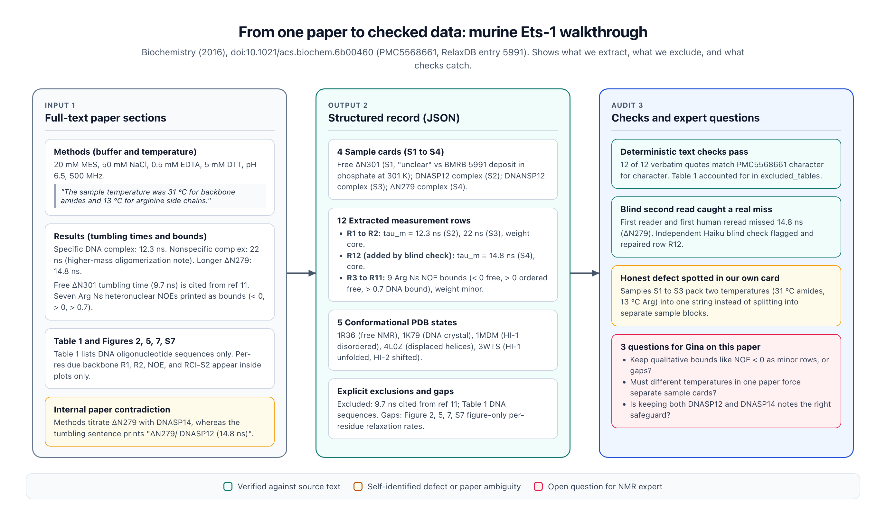

# Full-paper walkthrough: murine Ets-1 (`doi:10.1021/acs.biochem.6b00460`)

**Paper.** "Conformational Dynamics and the Binding of Specific and Nonspecific DNA by the Autoinhibited Transcription Factor Ets-1", *Biochemistry* 2016 ([`10.1021/acs.biochem.6b00460`](https://doi.org/10.1021/acs.biochem.6b00460), `PMC5568661`).  
**RelaxDB entry.** `5991` (mouse transcription factor Ets-1, `UniProt P27577`; deposited card lists BMRB `5991`, `301 K`, phosphate buffer, `500 mM NaCl`).

This walkthrough lets an NMR expert inspect every decision made between raw paper text and the extracted table for one complete article, including one bug we found in our own sample card and three boundary questions where expert guidance is needed.

---

## 1. What the paper actually contains

Reading the rendered PMC full text (`PMC5568661`), experimental dynamics appear across three sections.

1. **Global rotational tumbling (`τm`) by `15N` backbone relaxation (`Methods` and `Results`, lines 23, 55, and 58).**  
   Amide `15N` `R1`, `R2`, and `1H{15N}-NOE` spectra were acquired at `500 MHz` (`31 °C` for backbone amides) in `20 mM MES, 50 mM NaCl, 0.5 mM EDTA, 0.02% NaN3, 5 mM DTT, pH 6.5`.
   - *Verbatim quote (line 55).* "the effective isotropic rotational correlation time for the global tumbling of the specific ΔN301/DNASP12 complex was 12.3 ns."
   - *Verbatim quote (line 55).* "the nonspecific complex exhibited an effective correlation time of 22 ns." The authors immediately explain that slower `R1` indicates an average molecular mass above a `1:1` complex (possible higher-order oligomerization or multiple protein molecules per `DNANSP12` duplex, even at a `5:1` DNA ratio).
   - *Verbatim quote (line 58).* "with a modest increase due to the added mass of the SRR for ΔN279/ DNASP12 (14.8 ns) relative to ΔN301/DNASP12 (12.3 ns)."
   - *Previously published number left out (line 55).* "a value of 9.7 ns reported previously for free ΔN301 under similar conditions11".
2. **Arginine side-chain `15Nε` relaxation bounds (`Results`, lines 67 and 68).**  
   Measured at `13 °C` (`500 MHz`) rather than `31 °C`. No per-residue numerical table is printed in the text. Instead, Results prose prints qualitative `{1H}-15N` NOE bounds across 7 named arginines.
   - *Verbatim quote (line 67).* "In the free protein, the solvent exposed Arg391 and Arg394 in the DNA-recognition helix H3, as well as Arg309 and Arg311 in the inhibitory helix HI-1, are mobile on the sub-nanosecond time scale. This is evident by heteronuclear NOE values < 0 and relatively slow transverse R2 relaxation."
   - *Verbatim quote (line 67).* "Conversely, Arg373 and Arg374 in helix H2 and Arg413 in strand S4 show more restricted mobility with heteronuclear NOE values > 0."
   - *Verbatim quote (line 68).* "Upon binding of specific DNASP12, the mobile side chains of Arg391 and Arg394 become well-ordered as shown by heteronuclear NOE values > 0.7 and fast transverse R2 relaxation."
3. **What lives outside printable text or outside dynamics scope.**  
   - *Figures only.* Per-residue backbone `R1`, `R2`, `1H{15N}-NOE`, and `RCI-S2` appear exclusively inside `Figures 2, 5, 7, S7`, and `S8` (unavailable in text).
   - *Non-dynamics table.* `Table 1` prints DNA oligonucleotide construct sequences and lengths (`DNASP12`, `DNASP14`, `DNANSP12`, etc.), with no dynamics values.
4. **An internal inconsistency inside the source paper itself (`Methods` line 23 vs `Results` line 58).**  
   `Methods` (`line 23`) states "In the case of ΔN279, DNASP14 was added progressively to a final 2:1 ratio", and `Table 1` defines `DNASP14` (`14 bp specific DNA`). However, the `Results` sentence (`line 58`) prints "ΔN279/ DNASP12 (14.8 ns)".

---

## 2. What our pipeline wrote into the structured record

### Sample cards (`S1` to `S4`)

| ID | Construct & species relation | Ligand state | Printed conditions (`500 MHz`, `pH 6.5`, `20 mM MES, 50 mM NaCl`) | Same as BMRB `5991` deposit? |
|---|---|---|---|---|
| `S1` | Murine Ets-1 `ΔN301` (`301–440`), `target` | Free (`apo`) | `31 °C` backbone amides; `13 °C` Arg side chains *(bundled, see self-audit)* | `unclear` (MES vs `301 K` phosphate / `500 mM NaCl` deposit) |
| `S2` | Murine Ets-1 `ΔN301`, `target` | Specific `12 bp` DNA (`DNASP12`, `1.1:1` to `1.5:1`) | Same buffer, field, and dual temperatures | `no` (DNA complex) |
| `S3` | Murine Ets-1 `ΔN301`, `target` | Nonspecific `12 bp` DNA (`DNANSP12`, `5:1` ratio) | Same buffer, field, and dual temperatures | `no` (DNA complex) |
| `S4` | Murine Ets-1 `ΔN279` (`279–440`), `same_protein_other_construct` | Specific DNA (`Results` prints `DNASP12`, `Methods` prints `DNASP14`) | Backbone relaxation `31 °C` (`Methods`) | `no` (longer construct + DNA) |

### Measurement rows (`12` rows kept)

| Rows | Quantity | Printed value & unit | Residue(s) or scope | Sample & method | Weight | Provenance note |
|---|---|---|---|---|---|---|
| `R1` | `tau_m` | `12.3 ns` | `ETS domain well-ordered residues` (`Tensor2` global fit, `NOE > 0.6`) | `S2`, `M1` | `core` | Extracted on initial read; verbatim quote verified |
| `R2` | `tau_m` | `22 ns` | `ETS domain well-ordered residues` | `S3`, `M1` | `core` | Extracted on initial read; oligomerization caveat noted |
| `R12` | `tau_m` | `14.8 ns` | `global tumbling of the complex` | `S4`, `M1` | `core` | **Missed by reader 1 and human reread; caught by blind Haiku read** |
| `R3` to `R6` | `NOE` | `< 0` | `Arg309 Nε`, `Arg311 Nε`, `Arg391 Nε`, `Arg394 Nε` | `S1`, `M2` | `minor` | Sub-ns side-chain flexibility in free protein |
| `R7` to `R9` | `NOE` | `> 0` | `Arg373 Nε`, `Arg374 Nε`, `Arg413 Nε` | `S1`, `M2` | `minor` | Restricted salt-bridged side chains in free protein |
| `R10` to `R11` | `NOE` | `> 0.7` | `Arg391 Nε`, `Arg394 Nε` | `S2`, `M2` | `minor` | Ordered upon binding specific `DNASP12` |

### Conformational PDB states (`5` states) and explicit omissions

- **States extracted (`5`).** `1R36` (free NMR `ΔN301`), `1K79` (`ΔN301` bound to `5'-GGA(A/T)-3'` DNA crystal), `1MDM` (Pax-5 ternary complex, helix `HI-1` disordered while `HI-2` folded), `4L0Z` (Runx1 ternary complex, inhibitory helices displaced), `3WTS` (quaternary complex with `HI-1` unfolded and `HI-2` shifted). Notice that the single-pass reader originally missed all `5` states; our November 17 rule clarification and second read added them.
- **Explicit omissions.** Cited `9.7 ns` (`ref 11`); `Table 1` (`excluded_tables`, oligo DNA sequences only); `Figures 2, 5, 7` (`out_of_reach`, figure-only per-residue relaxation parameters).

---

## 3. What our audit caught, what slipped through, and questions for Gina

This single paper demonstrates both the strength and the current limit of our pipeline.

- **What worked.** Every one of the `12` rows carries an exact verbatim quote matching `PMC5568661`, `Table 1` was verified empty of dynamics numbers rather than overlooked, previously published numbers (`9.7 ns`) were excluded, and the blind second-family reader caught a real missing measurement (`14.8 ns` in `S4`) that both the initial reader and the first review pass had missed.
- **Self-identified defect in our own sample card.** Samples `S1` to `S3` bundled two experimental temperatures (`31 °C for backbone amides; 13 °C for arginine side chains`) inside a single sample block, leaving it slightly ambiguous at row level unless you match method `M1` (`31 °C`) versus `M2` (`13 °C`). In our next schema, distinct acquisition temperatures should split into distinct sample blocks (`S1a`, `S1b`).

**Three concrete questions for Gina on this walkthrough.**
1. **Prose bounds vs numeric rows.** Should qualitative inequality bounds printed only in Results prose (`heteronuclear NOE < 0` or `> 0.7`) count as `minor` numeric rows (`R3–R11`), or belong strictly in `Residue_sets`?
2. **Sample splitting rule.** Confirm that different temperatures (`31 °C` vs `13 °C` here) or different buffer isotope fractions (`~1.8% H2O` vs `90% H2O` in Barstar) must force separate sample IDs even when construct and buffer salts match.
3. **Author typo / contradiction handling.** In `S4`, preserving both `DNASP12` (Results typo) and `DNASP14` (Methods) in `ligand_state` and `notes` warns downstream users without inventing a silent edit. Does that match how you want paper internal contradictions recorded?
