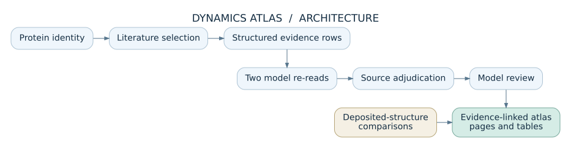
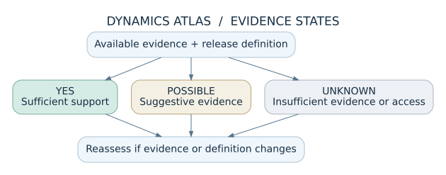

# Architecture and evidence states

These diagrams summarize the public 0.1 documentation. They are conceptual views, not an execution trace, exact module map, or a new scientific classification rule.

## Architecture

[Editable Mermaid](architecture.mmd) · [Editable SVG](architecture.svg) · [Graphviz source for SVG](architecture.dot)

1. Establish the protein identity before searching or choosing literature.
2. Extract structured observations and retain the source reference for inspection.
3. Have two model readers check the records separately. Adjudicate disagreements against the source. Under the documented fix, rows where both readers cannot verify also go to adjudication if the paper was read in full.
4. Review the resulting record and publish evidence-linked entries and tables. Keep deposited-structure comparisons separate from the literature call so correspondence is not confused with experimental proof.

## Evidence states

[Editable Mermaid](evidence-states.mmd) · [Editable SVG](evidence-states.svg) · [Graphviz source for SVG](evidence-states.dot)

The outcomes are calls under the release definition, not permanent properties of a protein. **Yes** denotes sufficient support under that definition; **possible** denotes suggestive but insufficient evidence; **unknown** means that the available record does not support a call. A stricter definition can change the classification. This is why the atlas exposes the supporting evidence and preserves uncertainty. New admissible evidence or a revised definition can prompt reassessment.

**Validation boundary.** The re-read, adjudication and review stages check agreement with the cited material. They are not an independent expert review, a replication of the experiments, or a benchmark score for a simulation model.

Sources: [public README](https://github.com/alex051107/dynamics-atlas-relaxdb) · [changelog](https://github.com/alex051107/dynamics-atlas-relaxdb/blob/main/CHANGELOG.md) · [quality report](https://github.com/alex051107/dynamics-atlas-relaxdb/blob/main/methods/quality.md)
