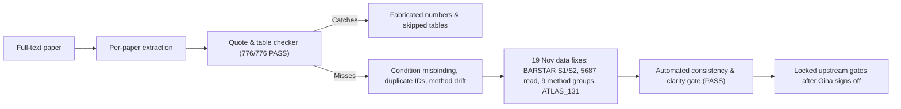
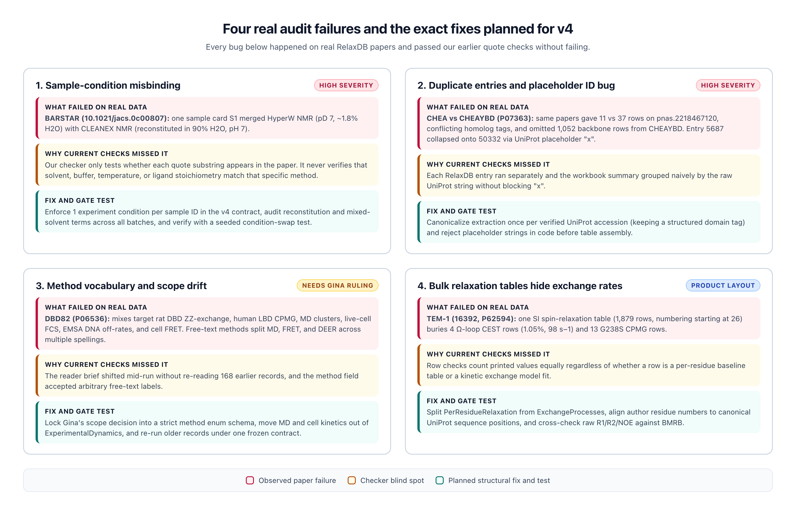

# Bugs found in audit and how we fix them

During our November 2026 audit across `131` open RelaxDB entries, we found five concrete failure modes. Every failure below occurred on real papers and slipped past our verbatim-quote checker without raising an error.

> **Status on 19 November 2026.** Concrete data-layer fixes for all five issues are now applied and verified in this branch ([`supplemental_20261119.json`](../data/v3_draft_20261118/supplemental_reads/supplemental_20261119.json), `55 / 55` verbatim quotes checked). `BARSTAR` `S1` is split into `S1` and `S2`. `5687` is separated from `50332` and read (`1P68`). All `85` raw method labels map cleanly into `9` controlled `method_group` buckets and `4` `row_tier` classes. `128 / 131` open entries now have full-text, October baseline, or twin-UniProt coverage, with `131` unified protein pages in [`atlas/ATLAS_131.md`](../atlas/ATLAS_131.md). Upstream automated gates for the next extraction pass remain queued behind Gina's sign-off on [`REVIEW_GUIDE.md`](../REVIEW_GUIDE.md).

## What current checks catch vs what slips through

---

## Bug 1. Sample-condition misbinding passes substring quote checks

**Real failure.** In Barstar (`BARSTAR`, [`10.1021/jacs.0c00807`](https://doi.org/10.1021/jacs.0c00807), `PMC7304870`), the authors measured HyperW HMQC at `50 °C` in `D2O` (`pD 7`, `~1.8% H2O` post-injection). They then lyophilized that sample and reconstituted it in `90% H2O` (`pH 7`) for CLEANEX-PM. Our original sample card `S1` merged both into one string (`pD 7 (HyperW, D2O); pH 7 (CLEANEX, ~1.8% H2O)`). A related issue appeared in Ets-1 ([`walkthrough_ets1.md`](../atlas/walkthrough_ets1.md)), where `31 °C` backbone and `13 °C` arginine experiments shared one `temperature` field.

**Why checks missed it.** Substring verification only tests whether quoted words exist in the paper. It does not check whether a solvent fraction, pH, temperature, or stoichiometry belongs to the specific method row pointing to it.

**Fixed now (19 Nov) vs next-pass gate.**
1. **Fixed in branch:** Split `BARSTAR` `10.1021/jacs.0c00807` into `S1` (HyperW, `pD 7`, `D2O -> ~1.8% H2O`) and `S2` (CLEANEX-PM, `pH 7`, `90% H2O`), backed by verbatim quotes from `PMC7304870`.
2. **Queued for next pass:** Require one experimental condition per `sample` ID in schema validation, run the mixed-solvent scanner across every paper, and test it with a planted condition-swap fixture.

---

## Bug 2. Duplicate RelaxDB entries and placeholder UniProt collapse

**Real failure.** RelaxDB filed *E. coli* CheA (`P07363`) under two entries, `CHEA` and `CHEAYBD` ([`CHEA_CHEAYBD.md`](../atlas/v3_previews/CHEA_CHEAYBD.md)). Reading both separately produced `11` vs `37` HDX-MS rows on [`10.1073/pnas.2218467120`](https://doi.org/10.1073/pnas.2218467120) and conflicting `homolog` tags on [`10.1007/s00723-018-1070-6`](https://doi.org/10.1007/s00723-018-1070-6). The foundational `15N` linker study ([`10.1021/bi951960e`](https://doi.org/10.1021/bi951960e), `1,052` rows) sat only under `CHEA`. Worse, the original summary builder treated placeholder `'x'` as a real UniProt ID, falsely collapsing entry `5687` (`Four helix bundle`) onto `50332` (`Iron-compound ABC transporter`).

**Why checks missed it.** Extraction keyed outputs by `(entry, DOI)` instead of verified `UniProt` accession, and the builder did not reject placeholder strings like `'x'`.

**Fixed now (19 Nov) vs next-pass gate.**
1. **Fixed in branch:** Separated `5687` from `50332`, read `5687`'s deposited paper (`10.1073/pnas.1835644100`, PDB `1P68`), and cross-linked every shared-UniProt pair (`CHEA`/`CHEAYBD` plus 6 other twin pairs) across `Proteins` and `atlas/all_proteins/`.
2. **Queued for next pass:** Index ingestion once per sequence-verified `UniProt` accession (carrying RelaxDB `entry` and `domain` as metadata) and block non-accession placeholders (`'x'`, blank) in code.

---

## Bug 3. Uncontrolled method names, scope drift, and un-reread older records

**Real failure.** In Glucocorticoid receptor ([`DBD82.md`](../atlas/v3_previews/DBD82.md)), `19` rows span rat `DBD` ZZ-exchange, human `LBD` CPMG dispersion, MD clusters, live-cell FCS (`ms`), EMSA DNA off-rates (`min`), and cell FRET. Across all `19,989` measurement rows, the raw `method` field carries `85` free-text variants (`md_simulation` vs `molecular_dynamics`, `FRET` vs `fret`, four `DEER` strings, three X-ray strings). Prompt rules also shifted mid-run (`67/108` edited during reread), leaving `168` older paper records (`78` source papers + `90` early PMC records) un-reread under newer state rules.

**Why checks missed it.** Schema checks verified non-empty strings instead of enforcing a closed enum for `method` and mechanism scope.

**Fixed now (19 Nov) vs next-pass gate.**
1. **Fixed in branch:** Mapped all `85` raw `method` strings (with `0` unmapped) into `9` controlled `method_group` buckets and `4` `row_tier` classes across both Excel and all `131` protein pages, keeping MD and cryo-X-ray strictly separated in Section 3.
2. **Queued for next pass:** After Gina rules on `Rank 1` and `Rank 2`, freeze one closed `method` list upstream and re-read the `168` older records under it.

---

## Bug 4. Massive bulk SI tables drown rare mechanistic exchange parameters

**Real failure.** In TEM-1 β-lactamase (`16392`, [`16392_and_BARSTAR.md`](../atlas/v3_previews/16392_and_BARSTAR.md)), one SI spin-relaxation table (`10.1021/bi060414q`) contributes `1,879` per-residue rows using construct numbering offset `+25` from Ambler numbering. Those baseline rows make up `98.3%` of the protein's `1,912` rows and visually bury the `4` WT Ω-loop CEST rows (`1.05 ± 0.03%`, `kex = 98 ± 6 s−1`) and `13` `G238S` CPMG dispersion rows.

**Why checks missed it.** Row-level checks treat every extracted row identically, without separating dense per-residue arrays from fitted exchange models.

**Fixed now (19 Nov) vs next-pass gate.**
1. **Fixed in branch:** Added `Exchange_Highlights` (`575` rows across `38` proteins) right after `Proteins` in the workbook, and separated `Experimental conformational exchange` (Section 1) from aggregated bulk relaxation summaries (Section 2) on all `131` protein pages.
2. **Queued for next pass:** Add canonical UniProt residue-number alignment and BMRB numerical cross-checks across all open entries.

---

## Bug 5. Disconnected coverage accounting and blind-check prevalence bias

**Real failure.** Before November 19, our November extraction and our October baseline sat in disconnected silos. That split hid the fact that `14` entries and `219` of the `244` earlier full-text DOIs were already curated in the October baseline, leaving only `7` truly untouched entries. Meanwhile, `96.7%` (`295/305`) of the Gemini pass printed zero numeric rows, so raw agreement hid the fact that all `4` blind disagreements landed in the small valued non-NMR subset (`DBD82`).

**Fixed now (19 Nov) vs next-pass gate.**
1. **Fixed in branch:** Reconciled the October baseline with November reads, read the `4` open-access untouched entries (`15451`, `5841`, `5687`, `CMTIV`) plus IscU `PNAS 2011` (`7432`), and logged BMRB/PubMed dossiers for the only `3` remaining paywalled entries (`15795`, `18477`, `50734`). Unified coverage is now `128 / 131` (`97.7%`).
2. **Queued for next pass:** Triage clinical/imaging noise before reading the `336`-row Kosmos package, pull institutional PDFs for the `3` paywalled entries, and report prevalence-adjusted agreement (`valuated-paper recall` and Gwet's `AC1`) separately on valued vs zero-row strata in [`quality.md`](quality.md).

---

## Bug 6. Physical-scope leaks (oligomer/binding rows) and Excel leading-`=` quote loss

**Real failure.** Two further defects surfaced during our independent replay check of the ten-tab export. First, `PLEXINB1` (`10.1021/jp310142f`) printed `approximately 90%` for the monomer-dimer fraction, and `20` additional titration/lineshape rows (`51416`, `50233`, `27888`, `CHEA`/`CHEAYBD`, `CSPA`, `CYPA_CPMG` substrate `koff`, `HTPDZ`) measured intermolecular binding or dimerization rather than conformational exchange. Second, two verbatim quotes starting with `=` (`=204 ns...` in `6470` and `= 6.5 ± 0.5...` in `GPIIA`) were stored as Excel formulas and disappeared as empty cells when reopened.

**Why checks missed it.** Keyword matching on `quantity = population` or `kex` does not separate intermolecular association from intramolecular conformational exchange, and opening an Excel workbook with cached formula values drops uncached strings starting with `=`.

**Fixed now (19 Nov) in the 15-tab Expert Review Workbook & companion SQLite DB.**
1. **Fixed in [`data/expert_review_20261119/RelaxDB_expert_review_DRAFT.xlsx`](../data/expert_review_20261119/README.md):** Added a 6-bucket `physical_scope` filter (`solution_conformational_exchange`, `association`, `crystal`, `simulation`, `other_experimental`, `unresolved`) that moves `PLEXINB1` `~90%` dimer and all `20` binding/oligomer kinetics rows into `association` while preserving genuine exchange (`16392` `1.05%` / `98 s-1`, `PLEXINB1` `T83` `Rex = 7.0 s-1`).
2. **Fixed in lossless export:** Forced literal text storage (`data_type = 's'`) on every quote and comparator starting with `=`, verified across `openpyxl` and LibreOffice Calc roundtrips (`0` lost rows across all `7` raw sheets; `0` formula cells in `Measurements`).

---

## Bug 7. Uncleaned numeric/unit traps, contradictory deposit flags, and missed Tier-1/Tier-2 raw tables

**Real failure.** Deep schema auditing caught three systematic traps in raw extraction and gap handling. First, `1,875` rows marked a mutant or other construct as `same_sample_as_deposit = yes`, and `207` values contained comma-thousands (`6,500`), ranges (`2,000-7,000`), flattened scientific notation (`(31 ± 2) × 102`), or PDF exponent traps (`104` ps for `10^4` ps in Ubiquitin `6470`). Second, text-only reading logged hundreds of `figure_only` gaps even when exact per-residue tables already existed in BMRB or Open Access supplementary Excel files. Third, raw BMRB deposits themselves contained `16` data traps (`18477` duplicated its `R2` table as `NOE`, `18257` uploaded unnormalized NOE peak intensities, and `17701`/`50734`/`5154`/`7056`/`18758` mislabeled `ms`, `s`, and `s-1`).

**Fixed now (19 Nov) in the 15-tab workbook and companion SQLite database.**
1. **ChEMBL-style cleaning and strict SQLite quarantine:** Appended clean numeric, canonical unit, and `data_validity_flag` columns to `Measurements`, left clean numeric cells blank on all `2,082` quarantined rows, and enforced a SQLite `CHECK` constraint blocking contradictory deposit flags at write time.
2. **Full-atlas Tier-1 BMRB recovery (`BMRB_recovered`):** Pulled `68` open-atlas BMRB IDs live (`62` with data, `37,131` per-residue values, `983` positive `Rex > 0`, `33` `Auth-Seq` offsets), including all `55 / 55` numeric open entries and all `3` paywalled BMRB entries (`15795`, `18477`, `50734`), while flagging and isolating all `16` deposit anomalies.
3. **Tier-2 AWS S3 SI inventory and Tier-3 figure policy (`SI_S3_inventory`, `Review_notes RN_10`):** Audited all `386` distinct gap DOIs (`346` OA PMCIDs, `242` S3 asset-ready, `43` direct spreadsheets) and parsed `20 / 20` prioritized spreadsheets (`12` verified dynamics tables including `HTPDZ`, `UVRDTD`, and `FSIB`). Locked a 3-tier figure policy so vision models only summarize isolated outliers and ranges rather than guessing dense scatter coordinates.
