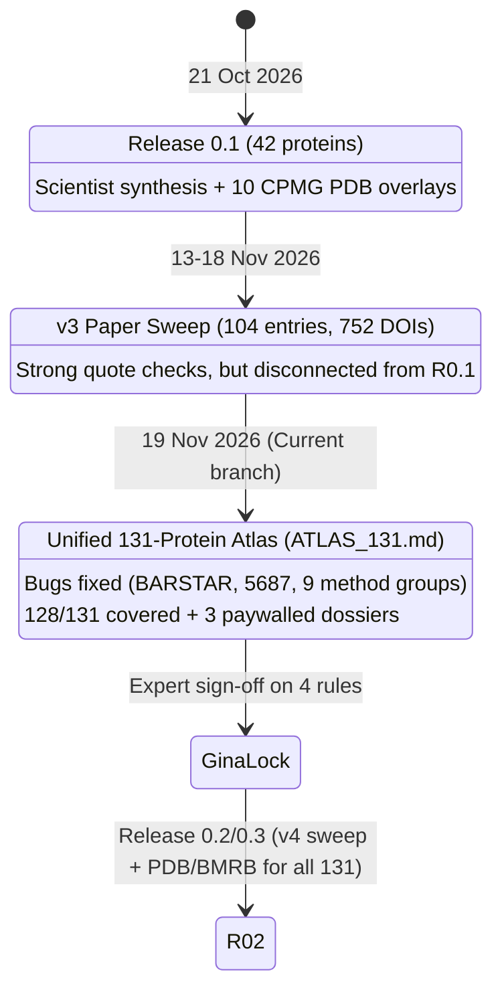

# Changes since Release 0.1 (`21 October -> 19 November 2026`)

This page tracks how Dynamics Atlas evolved from **Release 0.1** (`42` hand-curated alternate APO proteins) to our **Unified 131-Protein Draft (`review/expert-check-20261119`)**, and what remains for Release `0.2` and `0.3`.

---

## 1. Chronology from collaborator meetings to today

| Milestone | Scope & artifact | What improved | What regressed or remained open |
|---|---|---|---|
| **Sept 29 meeting & Slack notes** | Defined goal with Gina and Soojung (`10 CPMG -> 133 -> broader`), five required fields (residues, alternate states, experiments, timescale, % populations), and cross-method scope (CPMG/CEST, crystallography, FRET, EPR/DEER, MD). | Set clear scientist requirements and requested evidence + conflicts preserved per protein. | Left alternate APO vs all-timescale boundaries open until pilot examples reached Gina. |
| **Release 0.1 (`21 Oct 2026`)** | `42` RelaxDB proteins (`10` CPMG + `32` others): [`atlas/proteins/`](../atlas/README.md) (`13 yes, 18 possible, 11 unknown`), `data/*.csv`, `data/structures/` (`10` CPMG PDB overlays), raw BMRB checks (`data/relaxdb_data_issues.md`). | Produced scientist-first verdicts per protein, dual re-reads + adjudication, and structural state comparisons. | Covered `42 / 131` open proteins; slow to scale across dense multi-paper entries. |
| **Oct 22 meeting & Bindwell survey** | Team agreed to split source-grounded extraction from synthesis and adapt Bindwell's per-paper `rubric.json` benchmark. Surveys (`Oct 13-20`) compared Elicit, PaperQA2/3, Kosmos, OpenScholar, and Asta. | Established gold-key scoring, deterministic quote checks, and Step-1-only isolation for external retrieval tools. | Schema standardization and Gina's sign-off still waited. |
| **Nov 12 draft table** *(external workspace)* | `127` entries, `1,437` DOIs, `3,977` evidence rows. | Broad candidate intake testing open and citing literature. | Mixed `744` abstract-only DOIs with `full_text`; `219` of the `244` non-`v3` full-text DOIs turned out to be Release `0.1` papers. |
| **Nov 18 `v3` raw sweep** | `104` open entries (`752` DOIs, `771` records) extracted into a raw 9-tab workbook. | `85 / 86` core rates on 4 keyed papers (`102 / 102` Table 1 XML cells on arginine kinase); explicit `Gaps` and `States`. | Left Release `0.1` disconnected, dropped per-protein pages, and exposed `BARSTAR` condition misbinding, `5687` `'x'` collapse, and `85` free-text method strings. |
| **Nov 19 Unified 131-Protein Draft** *(current branch)* | [`atlas/ATLAS_131.md`](../atlas/ATLAS_131.md) (`131` protein pages), rebuilt 10-tab workbook (`19,989` rows, `575` exchange highlights, `776` records / `757` DOIs), `REVIEW_GUIDE.md`, `walkthrough_ets1.md`, `4` worked previews, `check_review_consistency.py`. | **Fixed** `BARSTAR` `S1`/`S2`, `5687` separation + read (`1P68`), `85 -> 9` controlled `method_group` + `4` `row_tier`, read OA entries `15451`, `5841`, `CMTIV`, and IscU `7432` (`+8` ZZ-exchange rows), bringing unified coverage to **`128 / 131` (`97.7%`)**. | `3` paywalled BMRB entries (`15795`, `18477`, `50734`), `336` Kosmos rows, `168` early un-reread `v3` records, Step 6 PDB/BMRB scaling beyond `10` CPMG entries, and Gina's sign-off on the 4 rules remain open. |

---

## 2. Gains locked in vs open work

### Gains we keep going into `v4`
1. **Per-paper answer-key calibration.** Against 4 manually verified keys (`arginine kinase`, `CRABP2`, `p38 gamma`, `IscU`), the extractor recovered `85 / 86` core rates and populations with `0` fabricated values (`102 / 102` arginine kinase Table 1 cells exact vs PMC XML).
2. **Unified 131-protein atlas structure.** Every open RelaxDB protein now has one readable page in [`atlas/ATLAS_131.md`](../atlas/ATLAS_131.md) separating solution exchange (Section 1), bulk relaxation (Section 2), and MD/cryo-X-ray (Section 3).
3. **Hard test-set isolation and automated consistency gates.** All `12` held-out entries stay physically blocked (`NoSealedEntryRead` proved in `WorkflowV3.tla`), and [`check_review_consistency.py`](check_review_consistency.py) blocks stale counts, broken links, path leaks, and malformed diagrams.

### Remaining items gated on Gina's review
1. **Upstream `v4` schema enforcement.** Lock Gina's 4 rules from [`REVIEW_GUIDE.md`](../REVIEW_GUIDE.md) into closed `method`/`scope` enums, mandatory single-condition sample splitting, and canonical UniProt indexing.
2. **Close the final external literature backlog.** Fetch institutional PDFs for the `3` paywalled entries (`15795`, `18477`, `50734`), pull and triage the `336`-row Kosmos package, and re-read the `168` early `v3` records under the frozen `v4` schema.
3. **Extend Step 6 (PDB overlays and raw BMRB checks).** Scale the Release `0.1` structural superposition (`data/structures/`) and BMRB residue-numbering checks from the `10` CPMG entries across all Tier 1 and Tier 2 proteins.
