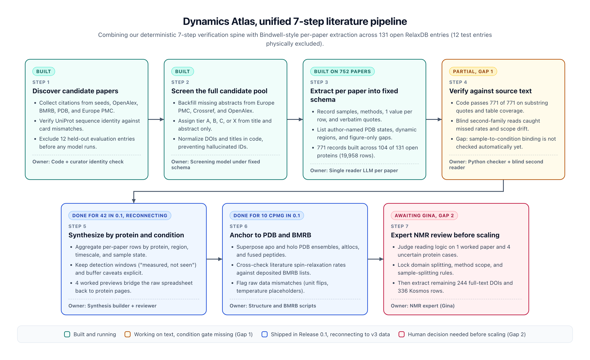
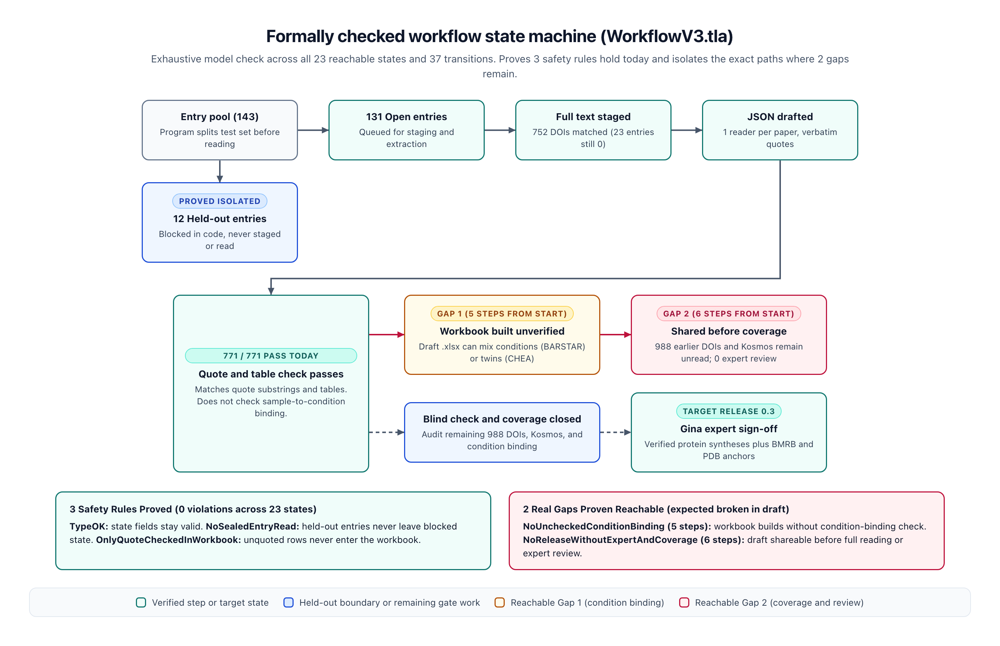

# How the atlas is built

Dynamics Atlas answers one practical scientific question from published structural biology and biophysics papers. For each protein, does experiment show conformational dynamics or alternate states, on what timescale, in which residues, and under what exact sample conditions? We framed that question with our collaborators on September 29 and October 22, 2026, linking each answer to PDB structures and deposited BMRB data.

Rather than inventing ad hoc prompts, our pipeline combines four verified components. It fuses **Bindwell's per-paper gold keys**, **Elicit's cited table pattern**, **deterministic Python gates around every LLM call**, and **expert NMR review**.

---

## 1. How other teams extract from papers, and what we fused

Before scaling beyond our 10-protein pilot, we surveyed curation benchmarks and production literature tools so we would reuse verified designs instead of reinventing them.

| External system or study | Core idea & published evidence | What we adopted vs rejected | How it maps to our files |
|---|---|---|---|
| **Bindwell** (*The Bitter Lesson for Biology*, shared by Soojung) | Write a gold `rubric.json` for each paper first, extract one printed value per row, and benchmark model/cost pairs (`Figure 12` & `13`) against the key rather than trusting intuition. | **Adopted** per-paper gold-key scoring, one-value-per-row extraction, and cost-accuracy benchmarking (`Haiku` `74/86` vs `Sonnet` `85/86` on 4 keys; `102/102` arginine kinase Table 1 cells vs PMC XML). **Rejected** copying Bindwell's binding-affinity Haiku tier blindly, because NMR dynamics requires separating fitted exchange rates from bulk relaxation arrays and prior citations. | `data/v3_draft_20261118/` workbook (`Measurements`, `Samples`, `Gaps`), `methods/quality.md` |
| **Elicit systematic review** | Split the job into screening then structured extraction, backing every cell with a supporting quote and letting humans override any row. | **Adopted** strict screen-before-read splitting (`Step 2` -> `Step 3`) and cell-level quote provenance. **Extended** with sample-condition separation audits because verbatim quotes alone do not stop a model from attaching a number to the wrong experimental condition (`arXiv:2609.15964`). | `code/tools/screen_candidates.py`, `methods/bugs_and_fixes.md` |
| **PaperQA2/3 (Edison Literature) & Kosmos** (FutureHouse) | Retrieval-augmented QA over full texts (`PaperQA2`: `85.2%` precision / `66.0%` accuracy on LitQA2) and shared-world-model discovery (`Kosmos`: `79.4%` accurate overall, `82.1%` literature, **`57.9%` synthesis/interpretation**, noting over-claiming and stochastic non-convergence). | **Adopted** Edison Literature strictly as an upstream **candidate-DOI discovery probe** (`Step 1`), alongside OpenAlex, BMRB, PDB, and Europe PMC. **Rejected** letting free-text agent synthesis write database claims or evidence tables directly without per-paper extraction and deterministic checks. | Candidate pool (`11,682` citations) and undownloaded Kosmos bundle (`336` rows) queued behind expert sign-off |
| **Ai2 Asta & OpenScholar** (*Nature* 2026) | Citation-grounded literature summaries. OpenScholar authors emphasize synthesis cannot be fully automated; Asta exhibited unstable reference lists across repeat runs (`arXiv:2606.08301`, surveyed Oct 13/20). | Confirms keeping candidate discovery deterministic and auditable, and reserving protein-level interpretation (`Step 5`) as a dedicated synthesis stage checked by independent readers and human experts (`Step 7`). | `atlas/ATLAS_131.md`, `atlas/README.md` (`42` October baseline syntheses), and `atlas/v3_previews/` |
| **WASP 2025, PubMed 39399004, PubTator 3.0 & Wood et al. 2026** | Linearizing tables line-by-line boosted F1 (`67.9%` vs `56.7%`); dual-LLM concordance gave `0.94` accuracy vs `0.41–0.50` on discordant cells; canonical database IDs curb hallucinations; human-in-the-loop sign-off remains consensus (*Bioinformatics Advances* 2026). Errors concentrate in condition binding (`arXiv:2512.10004`, `arXiv:2604.07584`). | **Adopted** row-by-row PMC XML table serialization, empty-table blocker checks, cross-family blind checks (`Claude` / `GPT` / `Gemini`), UniProt sequence-identity verification, and explicit Gina sign-off before release. **Applied** controlled `method_group` buckets and `BARSTAR` condition fixes on November 19. | [`bugs_and_fixes.md`](bugs_and_fixes.md), [`quality.md`](quality.md) |

---

## 2. Our unified 7-step workflow (status on 19 November 2026)

On October 13 we designed a 7-step deterministic workflow (`Astra` architecture review). Models operate inside bounded, schema-checked steps, while Python scripts enforce state, integrity, and release gates. Our **October baseline** (`21 October 2026`) ran the complete loop on `42` proteins. In November, we scaled `Step 3` using Bindwell's per-paper template and reconnected `Step 5` on November 19 across all `131` open entries in [`atlas/ATLAS_131.md`](../atlas/ATLAS_131.md).

| Step | What happens | Fixed rule (code) vs model judgment | Current status (19 Nov 2026) |
|---|---|---|---|
| **1. Discover & verify identity** | Pool citations from seed papers, OpenAlex, BMRB, PDB, Europe PMC, and Edison. Verify `UniProt` accession matches entry sequence; exclude `12` held-out test entries. | Fixed code enforces `12`-entry split and identity checks; curator fixes card errors (`HGMCSF` is G-CSF, `5991` is murine Ets-1). | **Built.** `11,682` candidates pooled; `5687` `'x'` collapse fixed; canonical UniProt indexing ready for the next pass (`Bug 2`). |
| **2. Screen candidate pool** | Backfill missing abstracts (`Europe PMC`, `Crossref`, `OpenAlex`); triage relevant papers from title & abstract; map DOIs in code. | Model assigns relevance tier under fixed prompt; Python handles backfill, DOI normalization, and missing-decision checks. | **Built** in October baseline code (`code/tools/screen_candidates.py`), queued before Kosmos intake. |
| **3. Extract per paper into fixed template** | Read one full text at a time into samples, methods, one printed measurement per row (with verbatim quote), PDB states, named dynamic regions, and figure-only gaps. | Prompt sets NMR/dynamics scope; borderline non-NMR methods and condition grouping involve model judgment until rules lock. | **Built for `757` unique DOIs (`776` records, `19,989` rows).** Combined with the October baseline, `128 / 131` open entries are covered; `3` paywalled entries (`15795`, `18477`, `50734`) have BMRB dossiers; `336` Kosmos rows wait on expert sign-off. |
| **4. Verify against paper text + blind audit** | Check every quote substring (`char-for-char`), value-inside-quote, non-empty table bodies, and spot-check blind with a second model family (`GPT`, `Claude`, `Gemini`). | Deterministic text checks (`776 / 776` pass); `check_review_consistency.py` enforces counts, links, and plain language; human curator adjudicates blind disagreements. | **Hardened on 19 Nov.** `BARSTAR` `S1`/`S2` fixed and `9` `method_group` buckets enforced downstream; upstream single-condition schema gate queued for the next pass (`Bug 1`, `Bug 3`). |
| **5. Synthesize by protein, region & condition** | Collapse raw rows into protein pages answering where it moves, timescale, populations, conflicts, detection windows, and buffer artefacts. | Fixed aggregation script groups verified rows and separates MD/cryo-X-ray from solution exchange; human expert reviews biological calls. | **Unified across all `131` open entries** in [`atlas/ATLAS_131.md`](../atlas/ATLAS_131.md) (`42` October baseline pages + `131` unified pages + `4` deep case studies). |
| **6. Anchor to PDB structures & raw BMRB** | Superpose apo/holo PDB ensembles (`Cα`, side-chain rotamers, `altlocs`, fused ligands) and cross-check literature relaxation rates against raw BMRB tables. | Deterministic structural alignment & BMRB parsers (`data/structures/`, `data/relaxdb_data_issues.md`). | **Done for `10` CPMG proteins in October; not yet extended to remaining `121` open entries.** |
| **7. Expert NMR review & sign-off** | Gina checks [`ATLAS_131.md`](../atlas/ATLAS_131.md), 1 full paper ([`walkthrough_ets1.md`](../atlas/walkthrough_ets1.md)), and 4 boundary rules ([`REVIEW_GUIDE.md`](../REVIEW_GUIDE.md)) before the next pass. | Human expert owns domain definitions, method inclusion, and condition-splitting rules. | **In review (open gate).** Intentionally pauses the next sweep and Release `0.2` promotion. |

---

## 3. Formal verification of the post-Anthropic Batch 1 workflow (27 November 2026)

We modeled our **post-Anthropic Batch 1 to ~8,000 scale workflow** in TLA+ ([`WorkflowPostAnthropic.tla`](statechart/WorkflowPostAnthropic.tla)) and audited two unguarded manual process shortcuts ([`WorkflowPostAnthropicRisk.tla`](statechart/WorkflowPostAnthropicRisk.tla)) against it. TLC exhaustively checked the locked model (`13` chart states and `14` transitions from `15` model states; `13` allowed states, `0` broken safety rules; [`summary.json`](statechart/summary.json)) and confirmed scaling approval is reachable in `6` steps ([`reachability_stories.md`](statechart/reachability_stories.md)).

- **Two rules are code-enforced today.** The `12` held-out test entries never enter staging, Anthropic extraction, QC, expert review, or broad scaling (`atlas_pipeline/schema.py`, `methods/check_review_consistency.py`). Raw Claude output never reaches expert sign-off without passing deterministic quote, physical unit, oligomer-vs-pB, and 5-slot condition checks.
- **Two manual shortcuts today are proved blocked by the locked workflow (`15` chart states, `28` transitions from `25` model states; `0` stay broken once locked).** First, no code lock stops launching ~`8,000` scaling before Batch 1 deterministic QC and Gina's spot-check finish ([`bug-1.png`](statechart/bug-1.png), `9` counterexamples). Second, no code lock stops marking a 1-week strict-abstain Batch 1 output as expert-approved without Gina's review ([`bug-2.png`](statechart/bug-2.png), `2` counterexamples). Full traces live in [`statechart/stories.md`](statechart/stories.md).
- **What the model leaves out.** The statechart checks gate order and label separation only. It does not cover paper paywalls, unverified RelaxDB-to-UniProt sequence mismatches, raster plot readability, prompt adherence drift, or API dollar cost.

| Step | What is checked | Who decides | Evidence file | Status |
|---|---|---|---|---|
| Exclude held-out & stage Batch 1 | Block `12` held-out entries; stage `12` open proteins and `3` proposed rules | Program (fixed rule) | `data/batch1_open_proteins_draft.json`, `PROPOSED_RULES_20261126.md` | **Done** |
| Lock 3 boundary rules | `keep`, `re-scope`, or `insufficient` on `AQADK`, `Plexin-B1`, `TEM-1 vs BRD4` | NMR Expert Gina (judgment) | `PROPOSED_RULES_20261126.md` | **NOT DONE YET** |
| 1-week strict-abstain fallback | Run Batch 1 marked `abstain` (not signed off) if no ruling arrives after 1 week | Fixed timer rule | `atlas_pipeline/ACTIVE_EXTRACTION_PROMPT.md` | **NOT DONE YET** |
| Extract 12 open Batch 1 proteins | Capture quantitative rows and qualitative observations under one canonical prompt | Anthropic / Claude (fixed prompt) | `ANTHROPIC_HANDOFF.md` | **NOT DONE YET** |
| Run deterministic Python QC | Check verbatim quotes, units, oligomer guard, 5-slot conditions, and log cost | Program (fixed rule) | `atlas_pipeline/schema.py`, `atlas_pipeline/compare.py` | **Code built; Batch 1 NOT DONE YET** |
| Spot-check Batch 1 & sign off | Review Batch 1 cards and resolve any `abstain` default records | NMR Expert Gina (judgment) | `ANTHROPIC_HANDOFF.md` | **NOT DONE YET** |
| Approve scaling toward ~`8,000` | Review Batch 1 QC metrics, expert sign-off, and cost before scaling | Project Lead (judgment) | `methods/statechart/summary.json` | **NOT DONE YET** |

---

## 4. Historical baseline: Release `0.1` (`21 October 2026`, `code/tools/`)

All scripts in [`code/tools/`](../code/tools/) implement our original `42`-protein **October baseline** (`13 yes`, `18 possible`, `11 unknown`). Those scripts and pages remain preserved intact alongside [`atlas/proteins/`](../atlas/README.md):

1. **Identity check.** Verified RelaxDB UniProt accession against entry sequence (`5` of `133` cards flagged).
2. **Four-channel search & screen.** Citation graph, BMRB, PDB primary citations, and Europe PMC fed abstract relevance triage (`Always read source paper`).
3. **Read, dual re-read, adjudicate & judgment.** Primary read -> independent Codex + Claude re-reads -> adjudication on flagged rows -> judgment claim per `(protein, region, time window, condition)` under [`definitions.md`](definitions.md).
4. **Structures.** Superposed rigid cores across downloaded PDB chains for the `10` CPMG entries (plus side-chain rotamers, `altlocs`, fused-peptide checks, and PDBe-KB comparison for CypA, RNase A, and K-Ras), stored in [`data/structures/`](../data/structures/).
