# How the atlas is built

An agent pipeline builds each record from the literature. Each step writes files, and the next step reads only those files. So every record can be traced back to sentences in papers. The code for each step is in [`code/tools/`](../code/tools/).

```mermaid
flowchart LR
  A[RelaxDB entry] -->|checks identity| B[Search]
  B -->|finds papers| C[Screen]
  C -->|selects papers| D[Read and fill]
  D -->|writes rows| E[Two re-reads]
  E -->|flags rows| F[Adjudicate]
  F -->|corrects rows| G[Draft judgments]
  G -->|writes record| H[Review]
  H -->|accepts record| I[Atlas page]
```

Start at the left. One protein goes through all steps before its page is published.

## Who does what

| Role | Who | Does |
|---|---|---|
| Worker | OpenAI Codex, one run at a time | Screens papers, reads them, fills evidence rows, re-reads rows |
| Second reader | Claude | Re-reads every row against the paper, independently of Codex |
| Adjudicator, drafter, reviewer | Claude subagents | Decide flagged rows, draft judgments, review them against the sources |
| Deterministic checks | Python scripts | Check that each number and quote is in the cited source, check the judgment schema, keep row IDs stable |
| People | The project lead and our NMR collaborator | Set the definitions, check examples, approve each change of a scientific claim |

The workers never see RelaxDB labels or test keys.

## The steps

1. **Identity check.** The UniProt accession on the RelaxDB card must match the card's sequence. A mismatch stops the entry until a person sets the accession. Five of the 133 cards had a wrong accession.
2. **Search.** The search uses names from UniProt, including all organisms with an identical sequence. It uses four channels: the citation graph of seed papers, BMRB entries of the same protein, PDB primary citations and Europe PMC queries. The paper that RelaxDB took its data from is a seed.
3. **Screen.** Each candidate paper gets a tier from its title and abstract: A (direct evidence), B (support), C (background) or X (not relevant). The RelaxDB source paper is always tier A.
4. **Read and fill.** The worker reads each A and B paper in full where it can. It writes one row for each paper, experiment and condition. Each row has a quote of at least eight words, its location and the sample conditions. A script checks that each number and quote is in the source text. For a scanned paper, macOS text recognition makes the text first.
5. **Two re-reads.** Codex and Claude each re-read every row against the source. A row goes to adjudication when one reader calls it wrong. It also goes there when both readers cannot verify it on a full-text paper.
6. **Adjudicate.** A reviewer opens the source and confirms or corrects each flagged row, with a quote. When a statement depends on subscripts, symbols or table cells, the reviewer reads the page image, not the text layer.
7. **Draft judgments.** A judgment is one claim about one region, in one time window, in one sample state. The drafter follows the rules in [`definitions.md`](definitions.md).
8. **Review.** A separate model opens each number and residue list in the sources and counts the errors it can verify. The fixes go back into the record.
9. **Publish.** The record becomes a page in [`atlas/`](../atlas/) and rows in [`data/`](../data/).

## Structures

For the 10 CPMG proteins we compared all downloaded PDB structures. We superposed each chain on its rigid core. Then we measured the mobile region against two reference chains that stand for the two states. For CypA, RNase A and K-Ras we also compared side-chain rotamers and alternate conformers. PDBe-KB conformational clusters give an independent check. The tables are in [`data/structures/`](../data/structures/).
